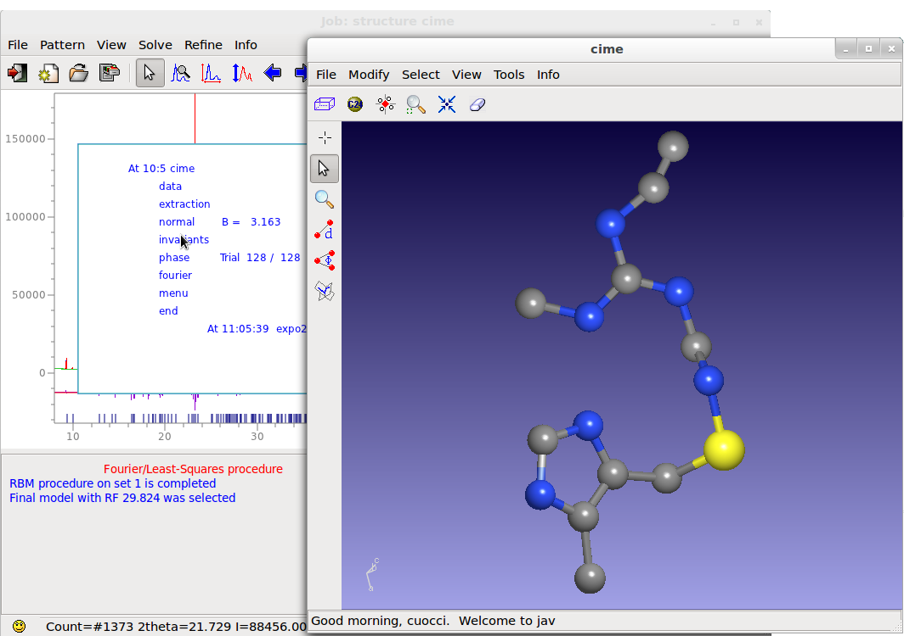
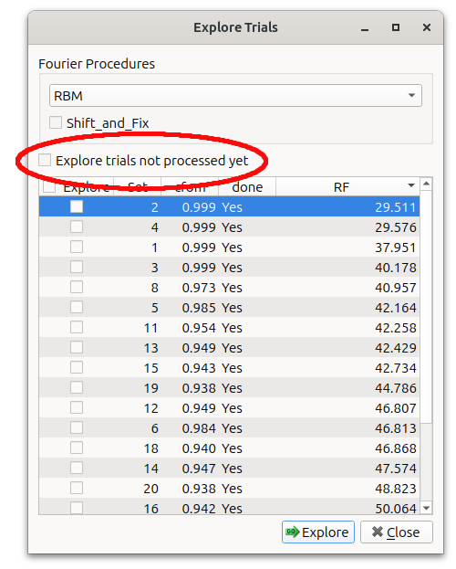
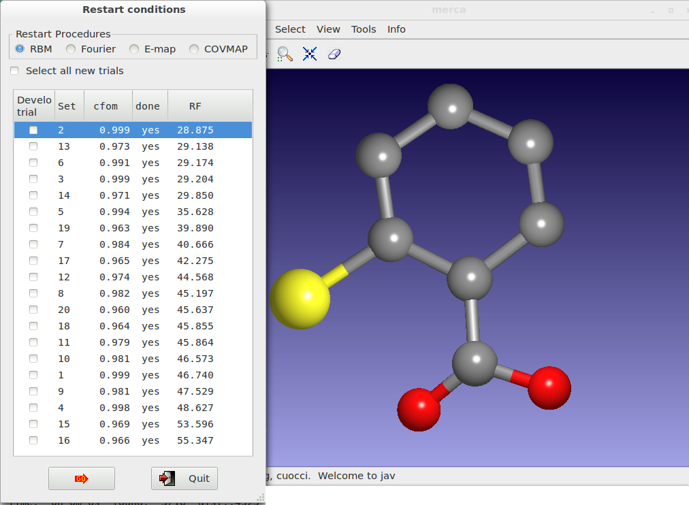
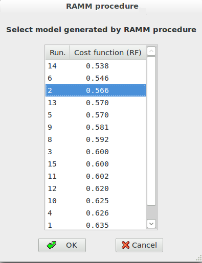

# Structure solution by Direct Methods

X-ray diffraction experiments provide the moduli of the structure factors, while their
phases are lost. Recovering the phases is essential for the *ab initio* solution of a
crystal structure: this is the **phase problem**. In EXPO the default strategy to solve
it is based on **Direct Methods** (DM) (Giacovazzo, 2013), which estimate the phases
directly from the structure factor amplitudes.

Applying DM to powder data requires a preliminary decomposition of the whole
experimental pattern, to extract the intensity of each reflection in the measured 2θ
range. Because of peak overlap, the estimated moduli are affected by unavoidable errors:
this weakens the efficiency of DM (wrong moduli produce wrong phases) and still makes
structure solution from powder data a challenge.

## Preparing the input file

To solve a structure with EXPO you need an input file (`.exp`), which can be:

- created from the graphical interface with **File → New Project**, choosing
  *Structure solution* by *Direct methods* and supplying the data file, the radiation,
  the cell parameters, the space group and the cell content;
- written or modified with a text editor (see
  [Preparing the input file](../input-file.md)) and loaded with **File → Load & Go**.

The cell parameters and the space group are assumed to be known (see
[Indexing](../indexing.md) and [Space group determination](../space-group.md)).
An input file for the structure solution of cimetidine is:

```text
%structure cime
%job structure cime
%data
pattern cime.dat
content (C10H16N6S)4
wavelength 1.52904
cell 10.6986 18.8181 6.8246 90.000 111.284 90.000
spacegroup p 21/a
synchrotron
%continue
```

## The steps of the solution

Click **Next** on the toolbar: the steps of the structure solution are performed
automatically. Each step corresponds to an EXPO command, and `%continue` runs all of
them with default settings, as if the following commands were given:

```text
%extraction
%normal
%invariants
%phase
%fourier
%menu
%end
```

| Step | Command | Description |
|------|---------|-------------|
| 1 | [`%extraction`](extraction.md) | extraction of the integrated intensities from the powder pattern |
| 2 | [`%normal`](normalization.md) | normalization of the integrated intensities by the Wilson method (Wilson, 1942) |
| 3 | [`%invariants`](invariants.md) | calculation of the triplet invariants and estimate of their phases by the P10 formula (Cascarano *et al.*, 1984) |
| 4 | [`%phase`](phasing.md) | phasing by the tangent formula: several sets of phases are generated and assessed by the combined figure of merit CFOM (Cascarano *et al.*, 1992). By default, at most 20 sets with the largest CFOM are stored, in decreasing CFOM order |
| 5 | [`%fourier`](fourier.md) | calculation of the Fourier map (E-map) with the set of phases with the largest CFOM; the most intense peaks are located and chemically interpreted, and the model is optimized and completed automatically |

At the end, the structure model is shown in the molecular viewer:



## When the default run fails

Many crystal structures are solved by EXPO with default settings, automatically and in
a few minutes. When the default run does not give the correct structure, the following
strategies can be applied at the end of the run.

### Exploring all the trials (ALLTRIALS)

Direct Methods generate several sets of phases (*trials*): at most 20 are stored, ranked
by the combined figure of merit CFOM, and only the trial with the largest CFOM is used
to compute the Fourier map. Because of the errors on the phases, the figure of merit may
fail to identify the best trial, so it is recommended to process the other trials with
**Solve → Explore Trials** (Altomare *et al.*, 2013a).

{ width="380" }

The window lists the CFOM of each stored trial. The trial with the highest CFOM is not
necessarily the correct one, especially when several trials have similar CFOM values.
For the trials already developed (*done* = *yes*) the window also shows R~F~, the
agreement between the structure factors extracted from the pattern and those calculated
from the corresponding model.

Tick the trials to develop in the first column and click **Explore**; with
**Explore trials not processed yet** all the trials not yet explored are selected. The
procedure used to optimize the model of each trial is chosen in *Fourier Procedures*
(see [Structure model optimization](#structure-model-optimization)):

| Procedure         | Description                                                                 |
|-------------------|-----------------------------------------------------------------------------|
| RBM               | Resolution Bias Modification; default for organic and metal-organic compounds (Altomare *et al.*, 2008a, 2008b, 2009, 2010a, 2010b) |
| Fourier recycling | classical Fourier refinement; default for inorganic compounds (Altomare *et al.*, 2006) |
| E-map             | only the electron density map computed directly after phasing                |
| COVMAP            | completion based on the covariance between map points (Altomare *et al.*, 2012) |
| Shift_and_Fix     | random shift of part of the model to improve the solution (Altomare *et al.*, 2017); see [below](#the-shift_and_fix-procedure) |

At the end, the trials are ranked by R~F~ and the model of each trial can be displayed
by selecting it:



The same procedure is activated in an input file by the `%alltrials` command:

```text
%structure merca
%job merca
%data
cell 7.885 5.976 14.949 90.0 100.48 90
spacegroup p 21/c
content C 28 O 8 S 4 H 24
pattern merca.xy
wavelength 1.54056
%alltrials
```

A complete example is described in
[Tutorial 2](../tutorials.md#tutorial-2-2-mercaptobenzoic-acid-exploring-the-phasing-trials).

### Structure model optimization

The model obtained at the end of the default run is often only partially correct: some
atoms are in the right positions, others are shifted or false. The Fourier map obtained
by Direct Methods can be improved by several optimization strategies:

- **suitably weighted least squares** (*w*LSQ) (Altomare *et al.*, 2006), which
  compensate for the low accuracy of the intensities of strongly overlapped
  reflections; applied automatically to inorganic compounds;
- **Resolution Bias Modification** (RBM) (Altomare *et al.*, 2008a, 2008b, 2009, 2010a,
  2010b), which reduces the errors of the electron density map due to the limited
  experimental resolution (peak broadening, peak shift, intensity distortion). The
  correction is applied in direct space (default for organic and metal-organic
  compounds), or in both direct and reciprocal space;
- **COVMAP** (Altomare *et al.*, 2012), an electron density modification based on the
  covariance between points of the map. The model provided by RBM is modified by COVMAP
  and then refined by *w*LSQ; the new model is processed again by COVMAP, cyclically.
  The number of cycles depends on the complexity of the structure.

The RBM procedures can be chosen from **Refine → Resolution Bias Modification (RBM)**:
*RBM (Direct Space)*, *RBM (Direct and Reciprocal Space)* and *RBM - COVMAP*.

### The RAMM procedure

RAMM (RAndom Model based Method) (Altomare *et al.*, 2013b) is an alternative route to
the *ab initio* solution when only the powder pattern and the chemical formula are
known. The classical approach has two steps: phasing by Direct Methods, which gives an
approximate and/or incomplete model, and optimization of that model. RAMM skips the
first step and feeds the optimization tools of EXPO (*w*LSQ, RBM and COVMAP) with
completely random models. Several random models are generated and optimized cyclically,
and the process stops automatically when the correct structure is recognized.

Select **Solve → RAMM Procedure** at the end of the default run. The procedure may take
from a few minutes to several hours, depending on the complexity of the problem (number
of atoms, data quality and resolution). If more plausible solutions are found, they are
listed in order of R~F~:

{ width="320" }

The selected model is shown in the molecular viewer; click **OK** to accept it. RAMM can
be very useful when Direct Methods fail. In an input file it is activated by the
`%random` command:

```text
%structure merca
%job merca
%data
cell 7.885 5.976 14.949 90.0 100.48 90
spacegroup p 21/c
content C 28 O 8 S 4 H 24
pattern merca.xy
wavelength 1.54056
%random
```

### The Shift_and_Fix procedure

Shift_and_Fix (Altomare *et al.*, 2017) aims to obtain a complete and correct solution
starting from an approximate, sometimes very rough, model. For each trial it starts from
the model given by Direct Methods and cyclically:

- shifts part of the model at random (possibly its least reliable part);
- combines Fourier map calculations and least-squares cycles to relocate the shifted
  atoms onto positions from which the standard optimization procedures can move them to
  the true ones;
- computes the Fourier map with coefficients that depend on the chemical content of the
  compound.

Select **Solve → Explore Trials** at the end of the default run and tick
**Shift_and_Fix**, together with **RBM** (organic and metal-organic structures) or
**Fourier recycling** (inorganic structures). It can be applied to all the trials
(recommended) or to selected ones.

## Suggestions

EXPO has many options. Besides the strategies above, the following ones may improve the
decomposition of the pattern or the performance of Direct Methods.

### Improving the decomposition

- Use good-quality data. If the pattern is very noisy at high 2θ, reduce the 2θ range
  with the `range` directive of `%data` or with **Pattern → Range**.
- If a partial structure has been found by the default run, it can be used to improve
  the extraction of the intensities: select **Solve → Recycle in Extra**.
- The `random` directive of [`%extraction`](extraction.md) activates a Monte Carlo
  procedure that counteracts the tendency of the Le Bail method to equipartition the
  intensity among strongly overlapped reflections, giving statistically more meaningful
  intensities.
- If the default run has revealed pseudo-symmetry, especially when a large fraction of
  the electron density is affected by it, this information can be used in the
  extraction (directive `yespseudo` of [`%normal`](normalization.md)).

### Improving Direct Methods

- The multi-solution process starts by default from *magic integers*. A random approach
  can be chosen instead with the `random` directive of [`%phase`](phasing.md).
- Triplet invariants are estimated by default by the second representation formula
  (P10), which is much more powerful than the first one. In case of failure, try the P3
  formula (directive `cochran` of [`%invariants`](invariants.md)) and/or increase the
  number of symbols in the phasing (directive `symbols` of [`%phase`](phasing.md)).
- EXPO always checks for pseudotranslational symmetry; unless requested, the information
  is reported but not used in the normalization and phasing. Use it with the directive
  `pseudotranslation` of [`%normal`](normalization.md).
- The number of reflections actively used in the phasing (*nref*) is set by EXPO. For
  some structures the ratio between active triplets and *nref* is too small (less than
  10): a larger *nref* may help (directive `nreflections` of
  [`%normal`](normalization.md)).
- High (or low) resolution reflections may be important for phasing. Fixing an
  isotropic thermal factor lower (or larger) than the one given by the Wilson plot may
  help (directive `bfactor` of [`%normal`](normalization.md)).
- Consider alternative space groups (directive `spacegroup` of `%data`).
- When the solution is still incomplete, difference or combined Fourier maps
  (F~o~ − F~c~, 2F~o~ − F~c~, F~o~) and/or Rietveld refinement can be computed from
  **Refine → Fourier** and **Refine → Rietveld**.

## References

- Altomare, A., Cuocci, C., Giacovazzo, C., Moliterni, A. G. G. & Rizzi, R. (2006).
  *J. Appl. Cryst.* **39**, 558–562.
  [doi:10.1107/S0021889806017912](https://doi.org/10.1107/S0021889806017912)
- Altomare, A., Cuocci, C., Giacovazzo, C., Kamel, G. S., Moliterni, A. & Rizzi, R.
  (2008a). *Acta Cryst.* A**64**, 326–336.
  [doi:10.1107/S0108767308004303](https://doi.org/10.1107/S0108767308004303)
- Altomare, A., Cuocci, C., Giacovazzo, C., Moliterni, A. & Rizzi, R. (2008b).
  *J. Appl. Cryst.* **41**, 592–599.
  [doi:10.1107/S0021889808011527](https://doi.org/10.1107/S0021889808011527)
- Altomare, A., Cuocci, C., Giacovazzo, C., Moliterni, A. & Rizzi, R. (2009).
  *Acta Cryst.* A**65**, 183–189.
  [doi:10.1107/S0108767309003687](https://doi.org/10.1107/S0108767309003687)
- Altomare, A., Cuocci, C., Giacovazzo, C., Moliterni, A. & Rizzi, R. (2010a).
  *J. Appl. Cryst.* **43**, 798–804.
  [doi:10.1107/S0021889810015499](https://doi.org/10.1107/S0021889810015499)
- Altomare, A., Cuocci, C., Giacovazzo, C., Moliterni, A. & Rizzi, R. (2010b).
  *Z. Kristallogr.* **225**, 548–551.
  [doi:10.1524/zkri.2010.1352](https://doi.org/10.1524/zkri.2010.1352)
- Altomare, A., Cuocci, C., Giacovazzo, C., Moliterni, A. & Rizzi, R. (2012).
  *Acta Cryst.* A**68**, 244–255.
  [doi:10.1107/S0108767311053281](https://doi.org/10.1107/S0108767311053281)
- Altomare, A., Cuocci, C., Giacovazzo, C., Moliterni, A., Rizzi, R., Corriero, N. &
  Falcicchio, A. (2013a). *J. Appl. Cryst.* **46**, 1231–1235.
  [doi:10.1107/S0021889813013113](https://doi.org/10.1107/S0021889813013113)
- Altomare, A., Cuocci, C., Giacovazzo, C., Moliterni, A. & Rizzi, R. (2013b).
  *J. Appl. Cryst.* **46**, 476–482.
  [doi:10.1107/S0021889813002227](https://doi.org/10.1107/S0021889813002227)
- Altomare, A., Cuocci, C., Moliterni, A., Rizzi, R., Corriero, N. & Falcicchio, A.
  (2017). *J. Appl. Cryst.* **50**, 1812–1820.
  [doi:10.1107/S1600576717015400](https://doi.org/10.1107/S1600576717015400)
- Cascarano, G., Giacovazzo, C., Camalli, M., Spagna, R., Burla, M. C., Nunzi, A. &
  Polidori, G. (1984). *Acta Cryst.* A**40**, 278–283.
  [doi:10.1107/S0108767384000556](https://doi.org/10.1107/S0108767384000556)
- Cascarano, G., Giacovazzo, C. & Guagliardi, A. (1992). *Acta Cryst.* A**48**,
  859–865.
  [doi:10.1107/S0108767392004240](https://doi.org/10.1107/S0108767392004240)
- Giacovazzo, C. (2013). *Phasing in Crystallography: A Modern Perspective.* Oxford:
  IUCr/Oxford University Press.
- Wilson, A. J. C. (1942). *Nature* **150**, 152.
  [doi:10.1038/150152a0](https://doi.org/10.1038/150152a0)
