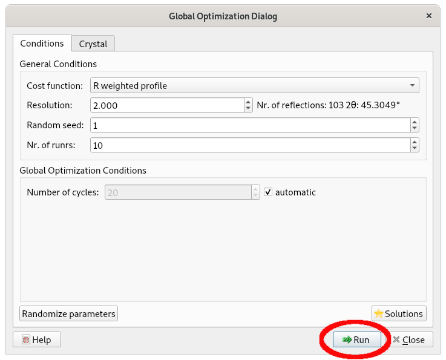
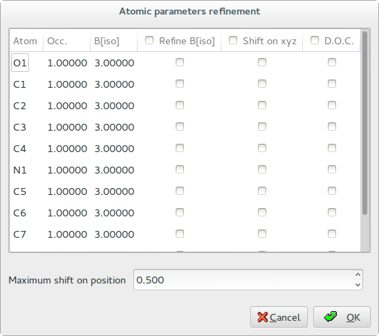
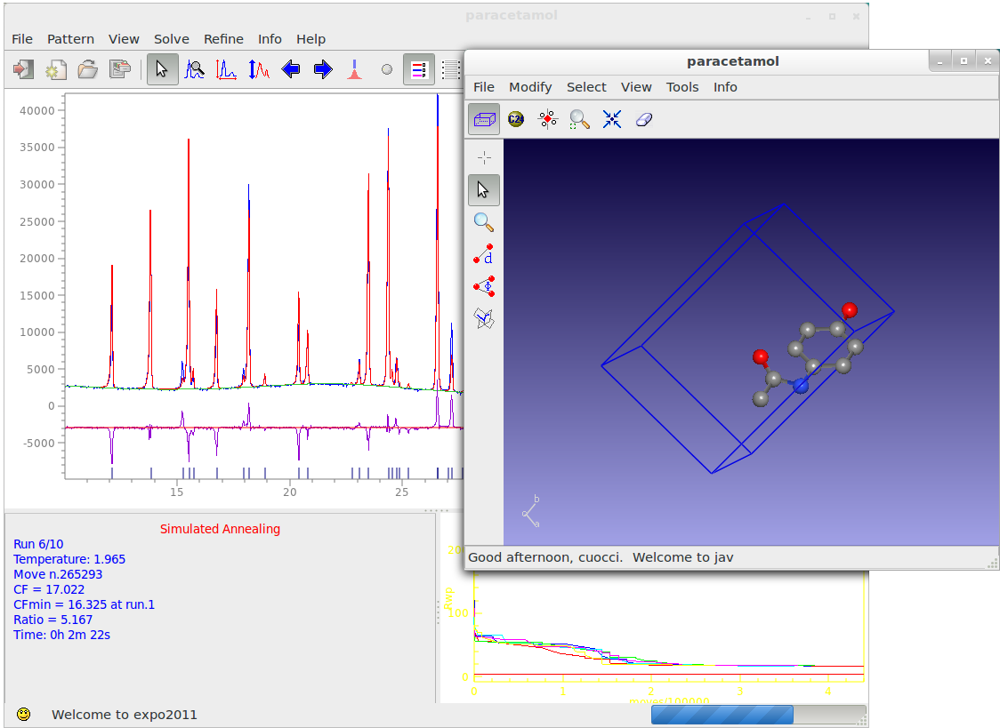

# Structure solution by direct-space methods

Direct-space methods for structure determination from powder diffraction data are widely
used and have solved organic, inorganic and organometallic structures. Several related
procedures exist (grid search, Monte Carlo, simulated annealing, parallel tempering,
genetic algorithms, particle swarm): each one generates a random sequence of trial
structures from a suitable 3D model, moving it until the calculated pattern matches the
observed one. Chemical knowledge reduces the number of parameters: bond distances, bond
angles and ring conformations are usually known and kept fixed, while only the torsion
angles are varied.

EXPO offers two direct-space algorithms:

1. a classical **simulated annealing** (SA);
2. the **hybrid Big Bang–Big Crunch** algorithm (*H*BB-BC) (Altomare *et al.*, 2013),
   which combines BB-BC with SA. It mimics one of the theories of the evolution of the
   universe, with two phases: the *Big Bang*, an energy dissipation that creates a
   completely random initial population, and the *Big Crunch*, a contraction that
   converges to a global optimum.

*H*BB-BC is used automatically for simple problems: at most 5 internal degrees of
freedom (torsion angles), at most 2 fragments and at most 11 refined parameters. In all
the other cases SA is used.

## Preparing the input file

The cell parameters and the space group are assumed to be known (see
[Indexing](../indexing.md) and [Space group determination](../space-group.md)).
The following input file, `paracetamol.exp` from the examples folder, solves the
structure of paracetamol by simulated annealing (see also
[Tutorial 3](../tutorials.md#tutorial-3-paracetamol-direct-space-methods)):

```text
%Structure paracetamol
%Initialize
%Job Paracetamol (C8H9NO2)
%Data
   Cell  7.100  9.380  11.708  90.0  97.42  90.0
   SpaceGroup p 21/n
   Pattern   paracetamol.xy
   Wavelength 1.54056
%fragment paracetamol.mol
%sanneal
```

Load it with **File → Load & Go**.

- `%fragment paracetamol.mol` imports the starting model, here in MDL Molfile format.
  The command can be repeated to import more fragments (see
  [The `%fragment` command](directives.md#the-fragment-command)). Other supported
  formats include MOPAC (`.mop`), Tripos Sybyl (`.mol2`, `.ml2`), CIF (`.cif`),
  Protein Data Bank (`.pdb`), Fenske-Hall Z-matrix (`.zmt`), EXPO free fractional
  format (`.frac`), XYZ (`.xyz`) and SHELX (`.ins`, `.res`).
- `%sanneal` opens the simulated annealing interface.

Instead of `%fragment`, the starting model can be imported from the graphical interface
with **File → Import Structure**, and fragments can be added to an existing model from
the structure viewer (**Modify → Add Fragment**). Instead of `%sanneal`, the simulated
annealing interface can be opened with **Solve → Simulated Annealing**.

## The starting model

The starting model is described as a combination of *scattering objects*: isolated
atoms, molecules, coordination polyhedra. For each fragment:

- the **position** is given by the fractional coordinates (*x*, *y*, *z*) of its centre
  of mass or of a pivot atom;
- the **orientation** is given by rotation angles around a set of orthogonal axes;
- the **internal geometry** is described by a set of *n* variable torsion angles
  {τ~1~, τ~2~, …, τ~n~}.

The same applies to two or more (identical or different) fragments in the asymmetric
unit. Bond lengths, bond angles and ring conformations are not varied, so they should be
as close as possible to those of the compound under study: an accurate 3D starting model
is essential.

The starting model can be prepared in two ways, or by combining them.

1. **From databases.** Look for similar molecules in the Cambridge Structural Database
   (CSD; organics and organometallics), the Inorganic Crystal Structure Database (ICSD;
   inorganics, elements, minerals and intermetallics), the
   [Crystallography Open Database](https://www.crystallography.net/) or the literature.
   For a new structure, significant molecular parts can often be found in known
   structures, and then modified and optimized. Open databases with 3D molecules in
   `sdf`, `pdb` or `mol` format are, for example,
   [PubChem](https://pubchem.ncbi.nlm.nih.gov/),
   [NIST Chemistry WebBook](https://webbook.nist.gov/chemistry/) and
   [DrugBank](https://go.drugbank.com/). A SMILES string can be converted into a 3D
   molecule in the structure viewer with **File → Import Fragment → From Smiles** or
   **Modify → Add Fragment → From Smiles**. Check that bond lengths are reasonable,
   e.g. against the standard values in *International Tables for Crystallography*,
   Volume C.
2. **By geometry optimization.** Build the molecule with a molecular editor, pre-optimize
   it with a force field and refine it with *ab initio*, semi-empirical or DFT
   calculations (MOPAC, Gaussian, GAMESS, NWChem, …); see
   [Geometry optimization](../tools/geometry-optimization.md). Free editors include
   [Avogadro](https://avogadro.cc/), [Gabedit](https://gabedit.sourceforge.net/),
   ACD/ChemSketch and MarvinSketch.

**Molecular crystals.** The description is straightforward: isolated molecules with known
connectivity are packed by weak intermolecular forces. It is important to know the
number of molecules in the asymmetric unit (*Z*′): usually one molecule, sometimes two or
more with different orientation or conformation (*Z*′ > 1); a molecule lying on a
crystallographic symmetry element occupies a special position, and the asymmetric unit
is a fraction of it (*Z*′ < 1).

**Inorganic materials.** They often consist of connected polyhedra whose topology is not
known *a priori*, so building the model is less straightforward. EXPO can generate
regular polyhedra (see [`%fragment`](directives.md#the-fragment-command)); the number of
polyhedra must be consistent with the expected number of atoms per cell (volume per
atom), and polyhedra may share corner atoms. These compounds usually have high symmetry,
with atoms on special positions. The **dynamical occupancy correction** (DOC)
automatically corrects the occupancy of atoms close to special positions or overlapping
with atoms of the same type. DOC is also useful when the composition is not exactly
known: more atoms than needed can be supplied, and DOC merges the excess ones. Structures
can also be solved by placing independent atoms at random positions, but the ratio
between observations (reflections) and parameters should be at least 8, or more depending
on data quality.

## The simulated annealing interface

The *Global Optimization* dialog has a **Conditions** page and one page for each crystal
phase, with the degrees of freedom of the model.



### Conditions

**Cost function**
:   Two cost functions (CF) are available. The default is the weighted profile
    agreement factor used in Rietveld refinement:

    $$
    R_{wp} = \sqrt{ \frac{\sum_i w_i \left[ y_{exp}(\theta_i) - y_{calc}(\theta_i) \right]^2}
    {\sum_i w_i\, y_{exp}(\theta_i)^2} } , \qquad w_i = \frac{1}{y_{exp}(\theta_i)}
    $$

    where $y_{exp}(\theta_i)$ and $y_{calc}(\theta_i)$ are the observed and calculated
    profile values at the *i*-th step. With $R_{wp}$ no extraction of structure factor
    moduli is needed, but a profile fitting is required; EXPO performs it automatically
    before the annealing. The alternative is the agreement factor between the
    integrated intensities extracted from the pattern, $I_{\mathbf{h}}^{exp}$, and those
    calculated from the model, $I_{\mathbf{h}}^{calc}$:

    $$
    R_B = \frac{\sum_{\mathbf{h}} \left| I_{\mathbf{h}}^{exp} - I_{\mathbf{h}}^{calc} \right|}
    {\sum_{\mathbf{h}} I_{\mathbf{h}}^{exp}}
    $$

    The intensities are extracted automatically by the Le Bail algorithm before the
    annealing. $R_B$ greatly reduces the computing time, but with severe overlap it can
    be unreliable, because the extracted intensities may be affected by large errors.

**Resolution**
:   maximum resolution used. Direct-space methods do not need the whole pattern: data up
    to 2 Å resolution are usually enough.

**Random seed**
:   seed of the random number sequence; with 0 the seed is taken from the system clock.

**Nr. of runs**
:   number of runs (default 10). A new seed is computed at the beginning of each run.

**Number of moves**
:   the number of moves at each temperature step is *N*~p~ × *N* × 20, where *N*~p~ is
    the number of refined parameters and *N* is the value entered. With *automatic*, *N*
    is chosen from the external and internal degrees of freedom and the flexibility of
    the molecule (see also the `niter` directive).

**Starting temperature**
:   with *automatic*, the starting temperature is determined at the beginning of the
    procedure.

**Temperature reduction factor**
:   factor applied to the temperature at each step of the annealing schedule (default
    0.90). Larger values improve the chance of finding the global minimum, at the cost of
    longer runs.

**Number of cycles**
:   number of cycles of the *H*BB-BC algorithm (*automatic* by default).

**Solutions**
:   browse the best solutions saved at the end of each run.

### Degrees of freedom

The page of each phase lists:

- **External DOF**: for each fragment, the translations and rotation to refine, with
  their lower and upper bounds, and the centre of rotation (centre of mass or an atom);
- **Internal DOF**: the torsion angles that can be refined, with their bounds.

**Atomic Parameters and Dynamical Occupancy Correction** opens the following dialog:

{ width="420" }

**Refine B[iso]**
:   refine the thermal parameters (click the column title to select all atoms). If the
    imported model has no thermal parameters, EXPO assigns B = 3.0 Ų to non-hydrogen
    atoms and B = 6.0 Ų to hydrogen atoms; the values can be edited. Refining thermal
    parameters is discouraged, as it usually does not improve the results.

**Shift on xyz**
:   refine the atomic positions: the fragment is no longer rigid, and the atoms are
    shifted with respect to its barycentre. This is generally discouraged, as it can
    considerably increase the time needed to reach the global minimum.

**Maximum shift on position**
:   maximum shift of the atomic positions (default 0.5). Larger values widen the explored
    parameter space and increase the risk of ending in a local minimum.

**D.O.C.**
:   apply the dynamical occupancy correction to the selected atoms: atoms on special
    positions or sharing the same position are detected automatically. Without it, all
    atoms are treated as in general positions (default). Select all atoms if you do not
    know which ones may fall on special positions; since DOC slows down the calculation,
    avoid it if no special positions or shared atoms are expected.

The preferred orientation can also be optimized (March–Dollase correction), giving its
direction (see the `po` directive).

### Running

Click **Run** to start. While the procedure runs, the observed and calculated patterns,
the minimum of the cost function versus the number of moves and the current model in the
structure viewer are updated:



Two toolbar buttons control the run:
{ height="22" } skips the current run and
{ height="22" } stops the procedure.

## Output

The output file contains:

- the starting crystal structure, the volume per atom and the connectivity;
- the internal and external degrees of freedom and the list of restraints;
- the optimized parameters;
- the details of each SA or *H*BB-BC run, and a summary of all runs.

The final structure of each run is saved in a CIF file named after the project with the
suffix `_best1`, `_best2`, … (e.g. `paracetamol_best1.cif` is the best solution,
`paracetamol_best2.cif` the second best). The number is the rank according to the cost
function.

## When the direct-space approach fails

1. **The default settings are not adequate**, especially for complex structures.
   Increase *Number of moves* and *Nr. of runs* in the *Conditions* page: they are the
   most important parameters for the success of the optimization. Doubling or, if
   needed, tripling the default number of moves helps to reach the global minimum. The
   directives `niter` and `nrun` set them in the input file. Complex problems also
   benefit from the [parallel version](parallel.md).
2. **The data quality is poor** and the pattern is not suitable for extracting the
   integrated intensities: use the $R_{wp}$ cost function.
3. **The starting model is wrong**: inaccurate bond distances and angles, wrong number of
   building blocks. Improve the model using the CSD or molecular editors, and check the
   volume per atom in the output file (about 15–20 ų per atom).
4. **The thermal factors are inappropriate**: check them against similar structures
   and/or refine them (see *Atomic Parameters and Dynamical Occupancy Correction* and the
   `optimadp` directive).
5. **The space group or the cell is wrong**: it may be necessary to run independent
   calculations testing different space groups and/or cell choices.

Restraints can also help: see [Restraints](directives.md#restraints).

## References

- Altomare, A., Corriero, N., Cuocci, C., Moliterni, A. & Rizzi, R. (2013).
  *J. Appl. Cryst.* **46**, 779–787.
  [doi:10.1107/S0021889813010571](https://doi.org/10.1107/S0021889813010571)
