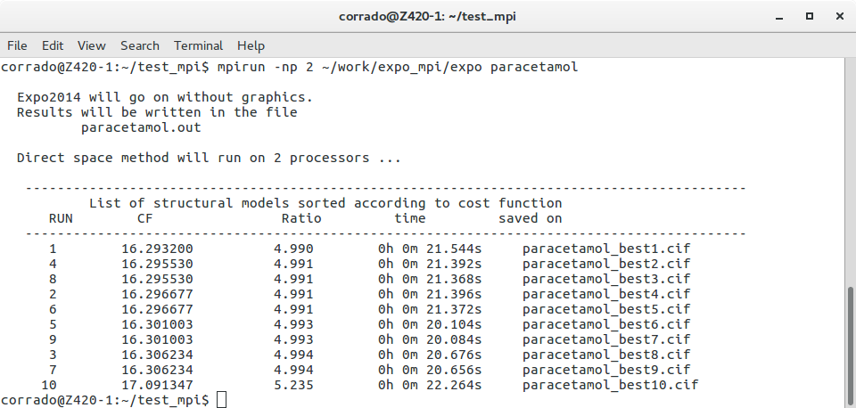

# Parallel execution

A parallel version of EXPO speeds up the structure solution by direct-space methods,
exploiting all the available processor cores. Parallelism is implemented with the
Message Passing Interface (MPI), and only the direct-space methods are parallelized.

Running in parallel makes it possible to tackle complex structures in a reasonable time.
Structures with more than 15–20 degrees of freedom, several fragments or very flexible
chains require many moves per run and many runs, to find the global minimum and to
increase the frequency of correct solutions. Moreover, the dynamical occupancy
correction and the restraints require the calculation of distances and angles between
neighbouring atoms, including all the symmetry-equivalent positions: with many atoms
these calculations can greatly increase the computing time.

Direct-space calculations are easily distributed among cores. In an MPI job several
copies of the program run independently, each with its own memory, and communicate
through the MPI library. In EXPO the runs of the global optimization are distributed
among the cores, and each core performs its own independent runs. At the end, the
solutions found by all the cores are collected by the master process, which ranks the
models by cost function and writes the output. Since the cores do not exchange data
during the runs, the communication overhead is practically zero and the speedup $S_p$
is almost equal to the number of cores, $S_p \lesssim N_{CPU}$.

## Requirements

- A computer with a multi-core CPU (laptop, desktop, workstation or cluster).
- Linux. On Windows, EXPO can run in parallel inside the
  [Windows Subsystem for Linux](https://learn.microsoft.com/windows/wsl/install) (WSL).
- [Open MPI](https://www.open-mpi.org/).
- EXPO built with MPI support:
    - the Debian packages on the [Download](../download.md) page are built with Open MPI;
    - when compiling from source, choose an MPI Fortran compiler such as `mpifort`
      (the default of `install.sh`) or `mpiifort`; see
      [Compiling from source](../installation.md#option-b-compiling-from-source-targz);
    - the [Docker image](../installation.md#option-c-docker-image) also includes the
      MPI version.

## Running in parallel

EXPO is run under MPI with `mpirun`, giving the number of MPI processes, the EXPO
executable and the input file:

```bash
mpirun -np 10 expo input_file.exp
```

`-np` sets the number of MPI processes, i.e. of running copies of EXPO; it should not
exceed the number of cores, to avoid degrading performance. In this example the
calculation is distributed among 10 cores. A default direct-space run performs 10 runs
of the global optimization, so each core performs one run. The number of runs can be
increased with the [`nrun`](directives.md#directives-of-the-procedure) directive; if the
number of processes exceeds the number of runs, the runs are automatically increased to
the number of processes, so that all the requested resources are used.

When EXPO runs in parallel the graphical interface is not displayed: the progress of the
job can be followed in the output file (`.out`). At the end EXPO writes a project file,
`name.expo`, which can be opened in the graphical interface with **File → Load Project**
or with

```bash
expo name.expo
```

The best solution is displayed. To see the list of all the models, select
**Solve → Simulated Annealing** and click **Solutions**.

### Example

The parallel version can be tested on paracetamol, from the examples folder. Copy
`paracetamol.exp`, `paracetamol.xy` and `paracetamol.mol` into a new directory (the
examples are in `share/expo/examples` under the EXPO installation directory, e.g.
`/usr/share/expo/examples` for the Debian package):

```bash
mkdir test_mpi
cd test_mpi
cp /usr/share/expo/examples/paracetamol.* .
```

and run, e.g. on a machine with 2 cores:

```bash
mpirun -np 2 expo paracetamol.exp
```

(give the full path of `expo` if it is not in the `PATH`). In a few minutes you get a
result like the following:



The working directory then contains `paracetamol.out` with the general information on
the job, the CIF files `paracetamol_best1.cif`, `paracetamol_best2.cif`, … with the best
models, and the project file `paracetamol.expo`. Open the project with
**File → Load Project** or with `expo paracetamol.expo`, then select
**Solve → Simulated Annealing** and click **Solutions** to inspect the best solutions.

With the Docker image the same test is run as described in
[Option C – Docker image](../installation.md#option-c-docker-image):

```bash
docker run --rm \
    -e PUID="$(id -u)" -e PGID="$(id -g)" \
    -v "$PWD:/work" \
    expo:xx.yy.zz mpirun -np 2 expo paracetamol.exp
```
