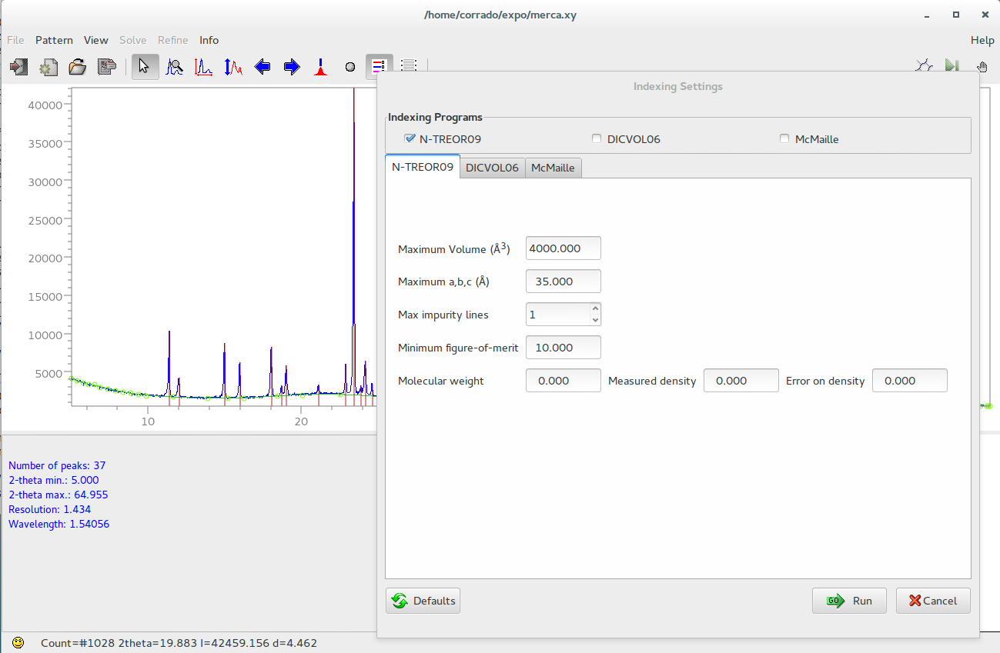
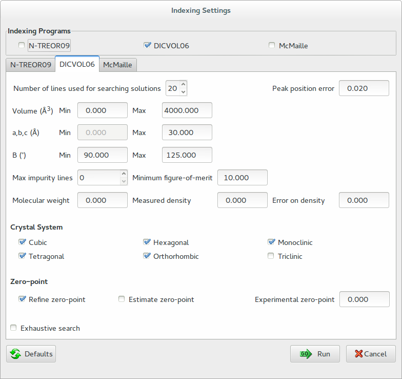
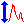
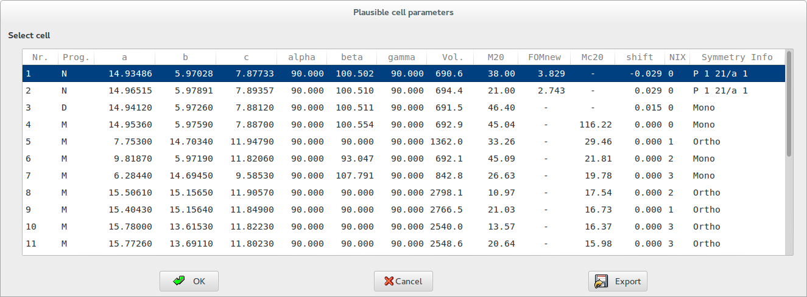
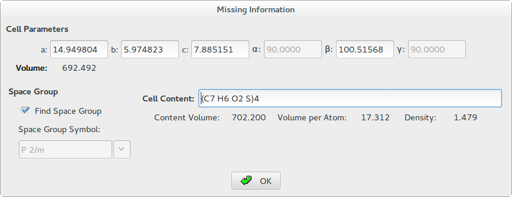

# Indexing

Indexing is the first step of the structure solution from powder diffraction data. Its
goal is to recover the unit cell parameters (*a*, *b*, *c*, α, β, γ) by assigning the
appropriate triple of Miller indices (*hkl*, or **h**) to each observed interplanar
spacing *d*~**h**~. In this way the three-dimensional unit cell is reconstructed from
the *d*~**h**~ values extracted from the one-dimensional experimental pattern.
A wrong unit cell makes the whole structure solution fail: finding the correct cell is
therefore essential.

EXPO indexes powder patterns with the program **N-TREOR09** (Altomare *et al.*, 2009),
the evolution of N-TREOR (Altomare *et al.*, 2000). In addition, EXPO can determine the
unit cell with two widely used, freely available indexing programs:
**DICVOL14** (Boultif & Louër, 2004; Louër & Boultif, 2014) and **McMaille** version 4.00
(Le Bail, 2004).

!!! note "DICVOL and McMaille on Linux and macOS"
    DICVOL14 and McMaille are distributed with EXPO as Windows executables (they are in
    the `bin` folder of the EXPO installation, e.g. `C:\Program Files\Expo2\bin` on
    Windows). On Linux and macOS they are run through
    [Wine](installation.md#third-party-software), which must be installed separately.

## Running the indexing

EXPO can index a powder pattern in three ways:

1. from the graphical interface, loading an EXPO input file (`.exp`);
2. from the graphical interface, loading a powder diffraction data file;
3. from the command line.

### 1. From an input file

Create a new input file (extension `.exp`) or modify an existing one, written with EXPO
or with a text editor (see [Preparing the input file](input-file.md)). Load it with
**File → Load & Go** and use the **Next** button of the toolbar to perform the steps of
the indexing procedure.

The command that activates the indexing by N-TREOR09 is `%ntreor`, which must follow
the `%data` command. Add `%continue` to carry out all the following steps of the
structure solution. An example is `cime.exp`, in the EXPO examples folder (see
[Tutorial 1](tutorials.md#tutorial-1-cimetidine-direct-methods-default-run)):

```text
%structure cime
%job cimetidine (C10H16N6S) -- Synchrotron data
%data
pattern cime.dat
wavelength 1.52904
synchrotron
%ntreor
%continue
```

The commands `%dicvol` and `%mcmaille` run the indexing by DICVOL14 and McMaille,
respectively. With the following input file the cell is searched, in sequence, by
N-TREOR09, DICVOL14 and McMaille:

```text
%structure cime
%job cimetidine (C10H16N6S) -- Synchrotron data
%data
pattern cime.dat
wavelength 1.52904
synchrotron
%ntreor
%dicvol
%mcmaille
%continue
```

### 2. From a powder diffraction data file

1. Load the data file with **File → Import Diffraction Pattern**.
2. Set the type and value of the experimental wavelength in the dialog window.
3. Choose the indexing program from **Pattern → Indexing** (N-TREOR09, DICVOL14 or
   McMaille).

As an example, load the file `merca.xy` from the examples folder and set the wavelength
to 1.54056 Å.

Choosing N-TREOR09, the *Indexing Settings* dialog opens:



The maximum cell volume, the maximum cell axes, the maximum number of impurity lines
and the minimum figure of merit M~20~ (de Wolff, 1968) of the candidate cells can be
changed here. If available, the measured density can be supplied together with its
error; the molecular weight is used only when the density is not zero. Clicking **Run**,
EXPO writes the N-TREOR09 input and runs the program.

Ticking **DICVOL14** or **McMaille** in the *Indexing Programs* frame activates the
settings of the corresponding program; clicking **Run**, EXPO writes its input file and
runs it.



Whatever indexing program is chosen, EXPO automatically locates and displays the peaks
that will be used to find the unit cell. The automatic peak search is skipped if the
peak positions (*d* or 2θ values) are already available, e.g. because a file of peaks
was loaded with **Pattern → Peaks → Load Peaks** before choosing the indexing program.

If the located peaks are reliable, click **Run**: they are refined and passed to the
indexing program. Otherwise click **Cancel**, modify the peak selection (see
[Selecting the peaks](#selecting-the-peaks)) and run the indexing again.

### 3. From the command line

To run the indexing without the graphical interface, prepare an input file with the
indexing commands (as in [method 1](#1-from-an-input-file)) and run:

```bash
expo cime.exp --nogui
```

The option `--auto` runs the same procedure with the graphical interface, but without
user interaction. See [Command-line usage](installation.md#command-line-usage) for the
other options.

!!! warning "Old command-line options"
    The options `-index=…`, `-wavel=…`, `-auto` and `-nogui` (with a single dash) of
    EXPO2014 are no longer supported: use an input file and `--nogui` or `--auto`.

## Selecting the peaks

Accurate and reliable peak detection is fundamental for a successful indexing. EXPO
locates the peaks by background subtraction, profile smoothing and the second
derivative method. The automatic peak search is sensitive to noise and to a wrong
estimate of the background, so its results should always be checked.

Use the zoom buttons of the toolbar to explore the pattern:
{ height="22" }
{ height="22" }
{ height="22" }
{ height="22" }
{ height="22" }.
If the automatic peak search is not reliable, the peak selection can be modified in
several ways:

1. **Changing the background.** Add or remove background points with the toolbar
   buttons { height="22" } and
   { height="22" }, or
   generate a new background from **Pattern → Background**. When the background
   changes, the peak positions are updated automatically.
2. **Adding or deleting peaks** with the toolbar buttons
   { height="22" } and
   { height="22" }
   (also available in **Pattern → Peaks**).
3. **Changing the search conditions** with **Pattern → Peaks → Peak Search
   Conditions**: 2θ interval, intensity threshold (all the peaks with percentage
   intensity larger than or equal to the threshold are selected), sensitivity and
   maximum number of peaks.
4. **Editing the peak list** with **Pattern → Peaks → Peak List**. For each peak the
   list shows 2θ, *d*, intensity (background subtracted) and full width at half
   maximum (FWHM). The 2θ and *d* values can be edited (intensity and FWHM cannot),
   and peaks can be added or deleted. Clicking a row marks the corresponding peak in
   the pattern.
5. **Loading or saving the peaks** (as 2θ or *d* values) with **Pattern → Peaks →
   Load Peaks / Save Peaks**.

## Output of the indexing

The main output file can be opened:

- with **Info → View Output File**, or the
  { height="22" } toolbar button;
- with a text editor: it is the file `name.out`, where `name` is the name given by
  `%structure` (when an input file is loaded) or the name of the data file without
  extension (when the data file is loaded from the graphical interface).

The output of each indexing program is available from **Pattern → Indexing → Output**:
`condens.out` for N-TREOR09, `dicvol_out.ord` for DICVOL14 and `mcmaille.imp` for
McMaille. The input files written by EXPO for DICVOL14 and McMaille (`dicvol_inp` and
`mcmaille.dat`) are in the working directory too.

## Directives for the indexing

### Directives of `%ntreor`

The default choices of N-TREOR09 can be changed through directives of the `%ntreor`
command. All the keywords of the indexing program TREOR (Werner, Eriksson & Westdahl,
1985) are accepted, with the same syntax (`KEYWORD=value,`). The most useful are:

| Keyword  | Meaning                                         | Default                    |
|----------|-------------------------------------------------|----------------------------|
| `VOL=`   | maximum cell volume (ų)                        | 4000 (2000)                |
| `CEM=`   | maximum cell axis (Å)                           | 35 (25)                    |
| `NIX=`   | maximum number of unindexed lines               | 1                          |

The defaults in brackets are used when the largest *d* value of the selected peaks is
not larger than 10 Å.

### Directives of `%data`

The following directives of `%data` control the list of peaks passed to the indexing:

| Directive               | Meaning                                                              |
|-------------------------|----------------------------------------------------------------------|
| `extefile <file>`       | reads the peaks from an external file (*d* values by default); the peak search and the refinement of the peak positions are skipped |
| `2-theta`               | the peaks in the `extefile` file are 2θ values instead of *d* values |
| `search min max n thr`  | peak search conditions: 2θ interval, maximum number of peaks, intensity threshold (%) |

## Remarks and suggestions

### Choosing the peaks

The indexing problem can usually be solved with the first 25 peaks (in order of 2θ),
including very weak ones. Low-angle peaks that are not clearly resolved and have an
appreciable width should be excluded, so that badly positioned peaks are not passed to
the indexing program.

If the indexing fails, try again gradually removing suspicious peaks (e.g. the weakest
ones or peaks on a shoulder). The failure may be due to impurity peaks and/or to missing
peaks. If weak peaks are missed, reduce the intensity threshold of the search
conditions. If an impurity phase is present as a minority phase, select only the most
intense peaks (about 20 are usually enough). Programs like N-TREOR09 and DICVOL14 can
index a pattern even if some peaks are missing, but may fail if many wrong or misplaced
peaks are used.

After the peak search, the peak positions and profile parameters are refined
automatically (with a Pearson VII profile function). The refined peaks can be saved with
**Pattern → Peaks → Save Peaks** and supplied to a new indexing run with the `extefile`
directive, skipping the peak search.

### Evaluating the solutions

At the end of the indexing, EXPO lists the plausible cells:



For each cell the list shows the indexing program (**N** for N-TREOR09, **D** for
DICVOL14, **M** for McMaille), the cell parameters and volume, the figure of merit
M~20~ (de Wolff, 1968), the zero shift, the number of unindexed lines (NIX) and the
symmetry information. For N-TREOR09 the figure of merit FOM~new~ (Altomare *et al.*,
2009) is also given, and the symmetry information is the most probable extinction
symbol; for McMaille the figure of merit McM~20~ is shown.

When more cells are found by more programs, the cells of each program are ranked by
its own figure of merit. With poor-quality data, several solutions may be proposed and
should be examined carefully, especially if their figures of merit are not high.
Clicking a cell in the list, tick marks at the bottom of the pattern show the calculated
positions of the Bragg reflections:

- each tick mark should correspond to a peak; a tick without a peak usually indicates
  a systematically absent reflection;
- a peak without a tick belongs to an impurity phase, or the cell is wrong. Unindexed
  peaks are marked by small filled circles above them.

The list of cells remains available from **Pattern → Indexing → Cell List**. The output
of each program (**Pattern → Indexing → Output**) contains further figures of merit,
e.g. F~20~.

For M~20~, de Wolff suggests that the indexing is reliable and substantially correct if
M~20~ > 10 and no more than 2 of the first 20 lines are unindexed; exceptions are
possible. With high-quality (e.g. synchrotron) data the M~20~ of the correct cell is
usually much larger than 10, while with laboratory data the correct cell may have M~20~
only slightly above 10.

### Using more programs

Running more than one indexing program increases the indexing power of EXPO: if one
program fails, another may succeed, and similar results from different programs
strengthen the confidence in the cell. N-TREOR09 and DICVOL14 are usually much faster
than McMaille, so it is better to run them first.

The default strategy of N-TREOR09:

- automatically corrects the 2θ zero shift;
- can index patterns containing one impurity peak;
- starts from the cubic system and, if no acceptable solution is found, explores the
  other crystal systems down to triclinic, stopping as soon as a plausible solution is
  found.

For DICVOL14 and McMaille these features are not part of the default strategy and can
be enabled in the graphical interface when a first indexing attempt fails. The search
for a triclinic cell can take a long time, depending on the program.

### Unit cell content

After the indexing, select a cell and click **OK** to proceed to the space group
determination. The following dialog appears:



Before clicking **OK**, specify the unit cell content. For 2-mercaptobenzoic acid the
cell volume suggests that the cell contains 4 molecules of C~7~H~6~O~2~S (Z = 4), so
the cell content is `(C7 H6 O2 S)4` (see
[Tutorial 1](tutorials.md#unit-cell-content) for the estimate of Z). While the cell
content is typed, EXPO displays:

Content Volume
:   an approximate cell volume, computed as the sum of the average volumes of the
    supplied atoms. It should be close to the cell volume computed from the cell
    parameters, shown below them.

Volume per Atom
:   the cell volume divided by the number of non-hydrogen atoms. It is expected to be
    close to 18 ų (the 18 ų rule), but significant deviations can occur, e.g. because
    of hydrogen bonds or large voids (as in zeolites). A reasonable range is
    15–22 ų.

Density
:   the density computed from the mass of the supplied atoms and the cell volume
    (g/cm³). The density of molecular compounds is relatively low, usually in the range
    0.9–2.0 g/cm³.

## Examples

The following input files are illustrative: their data files are not distributed with
EXPO.

**Example 1.** A zeolite with a large cell axis (73.6505 Å) and cell volume
(7194.74 ų). The file `vni.pea` contains the interplanar distances (*d*) supplied to
N-TREOR09, so the peak search is skipped.

```text
%structure vni
%job vni - Synchrotron data
%data
pattern vni.pow
wavelength 0.99975
synchrotron
extefile vni.pea
%ntreor
vol=10000, cem=80, nix=0,
%continue
```

A default run cannot find the correct cell because of the default limits on the cell
axes and volume (35 Šand 4000 ų). The directives `cem=80,` and `vol=10000,` raise the
limits to 80 Šand 10000 ų; `nix=0,` accepts only cells with no unindexed lines
(the default is one).

**Example 2.** The maximum number of unindexed lines is set to 3; the data file is not
in the default format, so its type is given with the `filetype` directive.

```text
%structure norbo_ag
%job norbo_ag - C7H10 - T = 85 K
%data
pattern norbo_ag.pow
filetype double
wavelength 0.85041
synchrotron
%ntreor
nix=3,
%continue
```

## References

- Altomare, A., Campi, G., Cuocci, C., Eriksson, L., Giacovazzo, C., Moliterni, A.,
  Rizzi, R. & Werner, P.-E. (2009). *J. Appl. Cryst.* **42**, 768–775.
  [doi:10.1107/S0021889809025503](https://doi.org/10.1107/S0021889809025503)
- Altomare, A., Giacovazzo, C., Guagliardi, A., Moliterni, A. G. G., Rizzi, R. &
  Werner, P.-E. (2000). *J. Appl. Cryst.* **33**, 1180–1186.
  [doi:10.1107/S0021889800006427](https://doi.org/10.1107/S0021889800006427)
- Boultif, A. & Louër, D. (2004). *J. Appl. Cryst.* **37**, 724–731.
  [doi:10.1107/S0021889804014876](https://doi.org/10.1107/S0021889804014876)
- de Wolff, P. M. (1968). *J. Appl. Cryst.* **1**, 108–113.
  [doi:10.1107/S002188986800508X](https://doi.org/10.1107/S002188986800508X)
- Le Bail, A. (2004). *Powder Diffr.* **19**, 249–254.
  [doi:10.1154/1.1763152](https://doi.org/10.1154/1.1763152)
- Le Bail, A. (2008). Structure solution. In *Principles and Applications of Powder Diffraction*, edited by
  A. Clearfield, J. H. Reibenspies & N. Bhuvanesh, pp. 261–309. Chichester: Wiley.
  [doi:10.1002/9781444305487.ch7](https://doi.org/10.1002/9781444305487.ch7)
- Louër, D. & Boultif, A. (2014). *Powder Diffr.* **29**, S7–S12.
  [doi:10.1017/S0885715614000906](https://doi.org/10.1017/S0885715614000906)
- Werner, P.-E., Eriksson, L. & Westdahl, M. (1985). *J. Appl. Cryst.* **18**, 367–370.
  [doi:10.1107/S0021889885010512](https://doi.org/10.1107/S0021889885010512)
