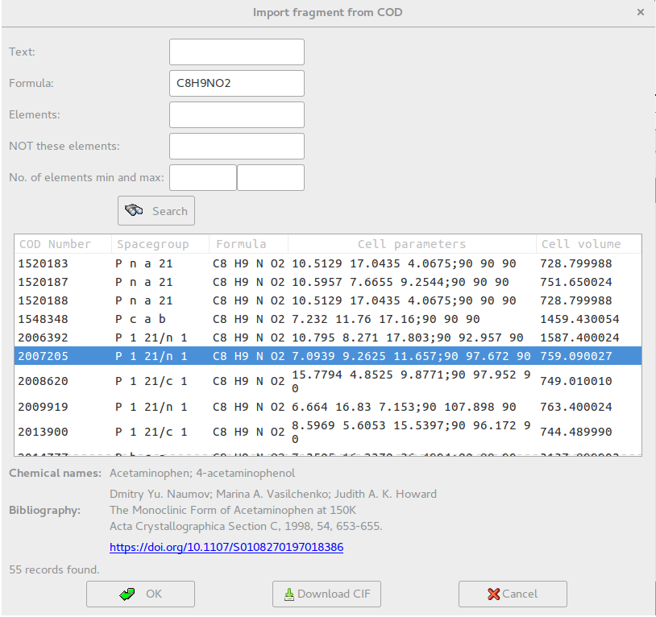

# Structure files

Crystal structures and molecular fragments are read and written from the **File** menu
of the structure viewer (JAV), and with **File → Import Structure** and
**File → Export Structure** in the main window. If the viewer is closed, open it with
**View → JAV Molecular Viewer**.

| Menu item | Description |
|-----------|-------------|
| **Import Structure** | load a crystal structure from a file |
| **Import Fragment** | add a molecular fragment: polyhedra, isolated atoms, a molecule from a SMILES string or a structure from the Crystallography Open Database (COD) |
| **Import Recent Structures** | reload one of the last structures opened |
| **Export Structure** | save the current structure to a file |
| **Export Scene** | save the displayed structure as an STL file, for 3D printing |
| **Screenshot** | save an image of the structure viewer |
| **Exit** | close the viewer |

In an input file, structures and fragments are imported with the
[`%fragment`](../direct-space/directives.md#the-fragment-command) command, and exported
with [`%export`](commands.md#the-export-command).

## Import

The following structure files can be read:

| Format | Extensions |
|--------|------------|
| [Crystallographic Information File](https://www.iucr.org/resources/cif) | `.cif` |
| MDL Molfile / SDF | `.mol`, `.sdf`, `.sd`, `.mdl` |
| [MOPAC](https://openmopac.net/manual/) input, in Cartesian or internal coordinates | `.mop` |
| Tripos SYBYL Mol2 | `.mol2`, `.ml2` |
| [Protein Data Bank](https://www.wwpdb.org/) | `.pdb`, `.ent` |
| Fenske-Hall Z-matrix | `.fhz`, `.fh` |
| [Free Form Fractional](https://open-babel.readthedocs.io/en/latest/FileFormats/Free_Form_Fractional_format.html) | `.fra`, `.frac` |
| XYZ Cartesian coordinates | `.xyz` |
| [SHELXL](https://shelx.uni-goettingen.de/) input/output | `.ins`, `.res` |

EXPO also reads the final geometry from the output files of quantum chemistry programs
(`.out`, `.log`), choosing the format in the file dialog: GAMESS, NWChem, MOPAC, ABINIT,
CRYSTAL and Quantum ESPRESSO (see [Geometry optimization](../tools/geometry-optimization.md)).

### Fragments

**Import Fragment** (or **Modify → Add Fragment**, to add it to the current model) offers
building blocks useful for the structure solution by
[direct-space methods](../direct-space/index.md):

- polyhedra: tetrahedron, octahedron, square plane, cube, trigonal plane, tetragonal
  antiprism, trigonal prism, icosahedron;
- isolated atoms;
- a molecule built from a SMILES string (**From Smiles**);
- a structure from the Crystallography Open Database (**From COD**).

### Crystallography Open Database

**From COD** opens a dialog to search the
[Crystallography Open Database](https://www.crystallography.net/) by text contained in
the entry metadata, chemical formula, elements present or absent, and minimum and
maximum number of elements. The queries use the RESTful API of COD.

{ width="560" }

The example shows the search for the formula of paracetamol, C~8~H~9~NO~2~. All the
entries with the requested formula are listed, with space group, cell parameters and
volume, and the 3D structure of the selected entry is displayed together with its
chemical names and bibliography. If a powder pattern has been loaded, the reflections
of the selected structure are computed and shown below the pattern in the main window,
for a visual comparison with the experimental data. **OK** imports the structure, and
**Download CIF** saves its CIF file.

## Export

The current structure can be written in the following formats:

| Format | Extensions |
|--------|------------|
| Crystallographic Information File | `.cif` |
| MDL Molfile | `.mol`, `.sdf`, `.mol2` |
| MOPAC, Cartesian coordinates | `.mop` |
| Protein Data Bank | `.pdb`, `.ent` |
| Fenske-Hall Z-matrix | `.fhz`, `.fh` |
| Free Form Fractional | `.frac` |
| XYZ Cartesian coordinates | `.xyz` |
| SHELXL | `.ins`, `.res` |
| [POV-Ray](https://www.povray.org/) scene | `.pov` |

Input files for quantum chemistry programs can also be written:

| Program | Extensions |
|---------|------------|
| GAMESS | `.inp`, `.gamin` |
| NWChem | `.nw` |
| Gaussian, Cartesian coordinates | `.com`, `.gau` |
| Gaussian, Z-matrix | `.gzmat` |
| ABINIT | `.in` |
| CRYSTAL | `.d12` |
| Quantum ESPRESSO | `.in` |

The GAMESS and NWChem input files contain the keywords for a DFT geometry optimization
with the B3LYP functional and the 6-31G* basis set, useful to obtain accurate starting
models for direct-space methods (see
[Geometry optimization](../tools/geometry-optimization.md)).

By default only the atoms of the asymmetric unit are exported. To export all the
displayed atoms, check **Displayed atoms** in the file dialog.

## Screenshot

Images of the structure viewer can be saved as PNG, JPEG, BMP, TIFF or Windows icon
(`.ico`) files. Check **Transparent** in the file dialog to obtain a transparent
background.
