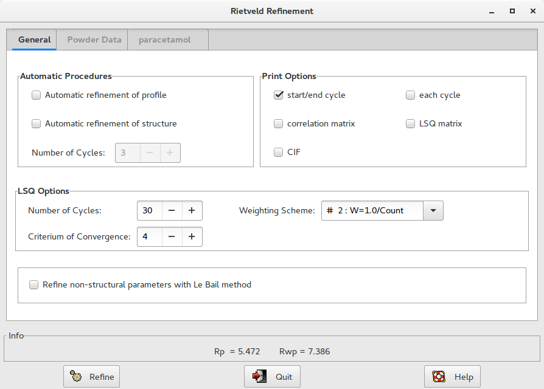
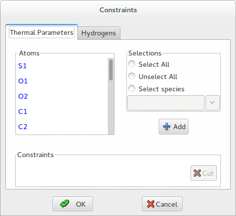
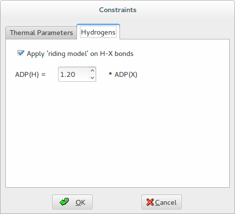
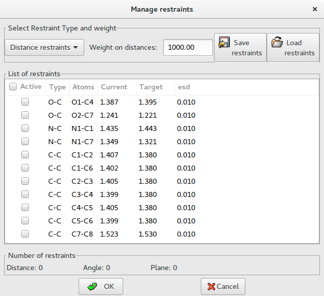

# Rietveld refinement

EXPO refines crystal structures by the Rietveld method (Rietveld, 1969), with graphical
and computing tools for automatic or user-defined refinements.

The refinable variables include peak shape parameters, unit cell parameters, fractional
coordinates, background coefficients, scale factor and isotropic displacement
parameters. Displacement parameters can be refined individually or for groups of atoms
(same element or same environment). Preferred orientation is corrected by the
March–Dollase approach.

- **Background**: Chebyshev polynomial, classical polynomial, cosine Fourier series,
  cubic spline or Bézier spline (with points that can be selected by mouse click on the
  pattern), or a filter.
- **Peak shape functions**: pseudo-Voigt, Pearson VII and TCH (Thompson–Cox–Hastings)
  pseudo-Voigt.

The non-linear least squares use the damped Gauss–Newton method. Convergence is reached
when the shifts of the parameters become small with respect to their standard deviations,
or when the relative gradient of the minimized χ² is below a tolerance. The tolerance and
the maximum number of cycles can be changed by the user.

A Le Bail full-pattern decomposition can be carried out before the Rietveld refinement,
to obtain good starting values for background, peak shape, zero shift and cell
parameters. This is recommended when the structure model is incomplete (McCusker *et
al.*, 1999) or very different from the final one.

The refinement can follow two approaches:

1. the user defines the refinement strategy in the graphical interface;
2. an automatic schedule refines groups of parameters in a fixed sequence, following the
   Rietveld refinement guidelines (Young, 1993); in the last step all parameters are
   refined together.

The molecular geometry can be used as restraints on bond distances, angles and planes
(see [Restraints](#restraints)).

## Figures of merit

The progress and quality of the refinement are assessed by the following figures of
merit, where $y_{i,obs}$ and $y_{i,calc}$ are the observed and calculated counts at the
*i*-th step, $y_{bi}$ the background, $w_i$ the weights, *N* the number of points of the
pattern and *P* the number of refined parameters:

$$
R_p = \frac{\sum_i^N |y_{i,obs} - y_{i,calc}|}{\sum_i^N y_{i,obs}} \times 100
\qquad
R_{wp} = \left[ \frac{\sum_i^N w_i (y_{i,obs} - y_{i,calc})^2}{\sum_i^N w_i\, y_{i,obs}^2} \right]^{1/2} \times 100
$$

$$
R_{exp} = \left[ \frac{N - P}{\sum_i^N w_i\, y_{i,obs}^2} \right]^{1/2} \times 100
\qquad
\chi^2 = \frac{\sum_i^N w_i (y_{i,obs} - y_{i,calc})^2}{N - P} = \left( \frac{R_{wp}}{R_{exp}} \right)^2
$$

The background-subtracted values $R'_p$, $R'_{wp}$ and $R'_{exp}$ are computed with
$y_{i,obs} - y_{bi}$ in the denominators, e.g.

$$
R'_{wp} = \left[ \frac{\sum_i^N w_i (y_{i,obs} - y_{i,calc})^2}{\sum_i^N w_i (y_{i,obs} - y_{bi})^2} \right]^{1/2} \times 100
\qquad
R'_{exp} = \left[ \frac{N - P}{\sum_i^N w_i (y_{i,obs} - y_{bi})^2} \right]^{1/2} \times 100
$$

The goodness of fit ($R_{wp}/R_{exp}$) and the Durbin–Watson *d* statistic are also
given. Agreement factors similar to those of single-crystal data are computed from the
*m* structure factors and intensities extracted from the experimental profile:

$$
R_F = \frac{\sum_j^m |F_{j,obs} - F_{j,calc}|}{\sum_j^m F_{j,obs}} \times 100
\qquad
R_B = \frac{\sum_j^m |I_{j,obs} - I_{j,calc}|}{\sum_j^m I_{j,obs}} \times 100
$$

During the refinement EXPO shows the observed, calculated and difference patterns with
the cumulative χ², and the evolution of the structure model in real time.

## Running the refinement

The cell parameters and the space group are assumed to be known, and a structure model
must be available. A typical input file is:

```text
%Structure paracetamol
%Job paracetamol
%Data
Cell  7.100  9.380  11.708  90.0  97.42  90.0
SpaceGroup p 21/n
Pattern   paracetamol.xy
Wavelength 1.54056
%fragment paracetamol.cif
%rietveld
```

`%fragment` imports the structure model and `%rietveld` opens the Rietveld refinement
interface. When a structure model is already loaded (e.g. at the end of a structure
solution), the interface is opened with **Refine → Rietveld**.



The **General** page contains:

- **Automatic Procedures**: automatic refinement of the profile and/or of the structure,
  repeated the given number of times;
- **Print Options**: information printed in the output file (at start/end or at each
  cycle, correlation matrix, least-squares matrix) and CIF output;
- **LSQ Options**: number of least-squares cycles, convergence criterion and weighting
  scheme (*w* = 1, *w* = 1/count or *w* = 1/count²);
- **Refine non-structural parameters with Le Bail method**: Le Bail decomposition
  before the refinement.

The **Powder Data** page contains the profile, background and instrumental parameters,
and the page with the structure name the structural parameters, constraints and
restraints.

## Constraints

Constraints are exact mathematical relationships between least-squares parameters, and
reduce the number of refined parameters.

**Symmetry constraints**, required by the space group symmetry, are deduced and imposed
automatically. For example, an atom on the special position (½, ½, ½) in *P*-1 is not
refined at all, while an atom on the special position (*x*, *x*, *x*) in *P*23 can be
refined, with equal shifts along *x*, *y* and *z*. The lattice symmetry imposes
relationships between the cell parameters (e.g. *a* = *b* = *c* and α = β = γ for
cubic cells).

Constraints are often used for **site occupancies** in disordered structures; in
minerals, a site can be occupied by atoms of different elements. If atoms A, B and C
fully occupy the same site, then occ~A~ + occ~B~ + occ~C~ = 1, so only two occupancies
are refined (e.g. occ~C~ = 1 − occ~A~ − occ~B~), and the displacement parameters shift
together. EXPO automatically identifies atoms sharing the same site and constrains their
occupancies and displacement parameters.

Further constraints can be defined by the user. The **Constraints** button in the
*Structure* section of the structure page opens a dialog to define groups of
displacement parameters with the same shift.

{ width="360" }

Hydrogen atoms are constrained by the **riding model**: they move together with the atom
they are bonded to, preserving bond length and direction. Their isotropic displacement
parameters are 1.2 times that of the bonded atom; the factor can be changed in the
graphical interface.

{ width="360" }

### The `constr` directive

Constraints can also be given in the input file with the directive `constr` after
`%rietveld`:

```text
constr constraint_equation
```

For displacement parameters the equation is a chain of equalities,
`constr B(At1) = B(At2) = B(At3) = …`, where `At1`, `At2`, … are atom labels or order
numbers. `*` selects several atoms:

| Directive | Effect |
|-----------|--------|
| `constr B(La1) = B(La2)` | equal displacement parameters for La1 and La2 |
| `constr B(C1) = B(C2) = B(C3) = B(C4) = B(C5) = B(C6)` | equal displacement parameters for C1–C6 |
| `constr B(C*)` | the same for all carbon atoms |
| `constr B(C*) = B(O*)` | equal displacement parameters for all C and O atoms |

When different atoms occupy the same site, their coordinates and occupancies must be
constrained, and usually their displacement parameters too. For La1 and Sn1 fully
occupying the same site:

```text
constr xyz(La1) = xyz(Sn1)
constr occ(La1) + occ(Sn1) = 1
constr B(La1) = B(Sn1)
```

## Restraints

The molecular geometry can be introduced as restraints on bond distances, angles and
planes. EXPO derives the possible restraints from the connectivity of the starting
model, listing their current and target values; the user selects those to apply and
can modify the target values.

{ width="480" }

The target values can be chosen with the directive `res_target_type` after `%rietveld`:

| Directive | Target values |
|-----------|---------------|
| `res_target_type table` | from tables of standard values |
| `res_target_type current` | equal to the current values of the model |
| `res_target_type optimization` | from a molecular mechanics optimization |

For structures solved by direct-space methods, bond distances and angles are usually
accurate, and `res_target_type current` is a convenient choice.

## Directives of `%rietveld`

| Directive | Description |
|-----------|-------------|
| `constr equation` | user-defined constraint (see [above](#the-constr-directive)) |
| `res_target_type type` | target values of the restraints: `table`, `current` or `optimization` (see [Restraints](#restraints)) |
| `load file` | read restraints from a file |
| `weid w`, `weia w`, `weip w` | weights of the distance, angle and plane restraints |
| `extraction` | carry out only a Le Bail decomposition of the pattern, instead of the Rietveld refinement |
| `pawley` | carry out only a Pawley decomposition of the pattern, instead of the Rietveld refinement |
| `cif` | write the refined structure in CIF format |
| `verbose` | more detailed output |

The directives for the model described in
[Directives and restraints](direct-space/directives.md#directives-for-the-model) (e.g.
`rest`, `optimadp`, `po`) are also accepted.

## References

- McCusker, L. B., Von Dreele, R. B., Cox, D. E., Louër, D. & Scardi, P. (1999).
  *J. Appl. Cryst.* **32**, 36–50.
  [doi:10.1107/S0021889898009856](https://doi.org/10.1107/S0021889898009856)
- Rietveld, H. M. (1969). *J. Appl. Cryst.* **2**, 65–71.
  [doi:10.1107/S0021889869006558](https://doi.org/10.1107/S0021889869006558)
- Young, R. A. (1993). *The Rietveld Method.* Oxford: IUCr/Oxford University Press.
