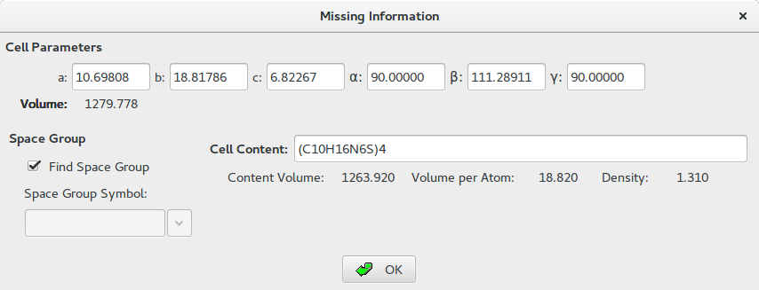
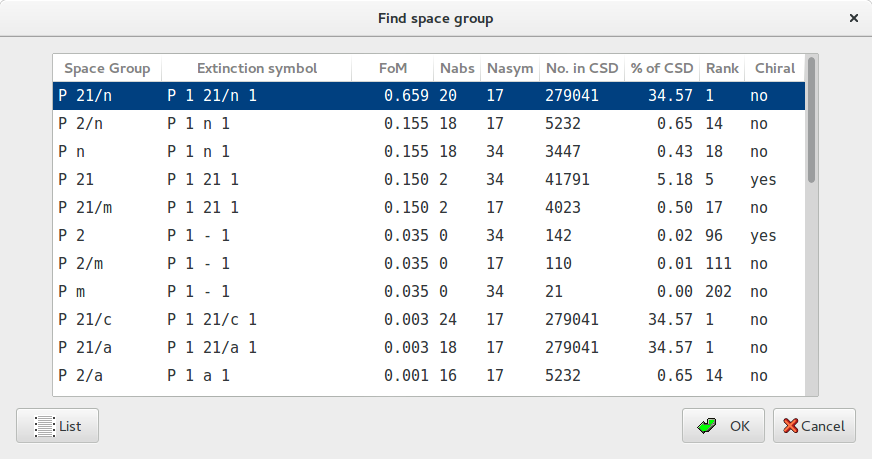
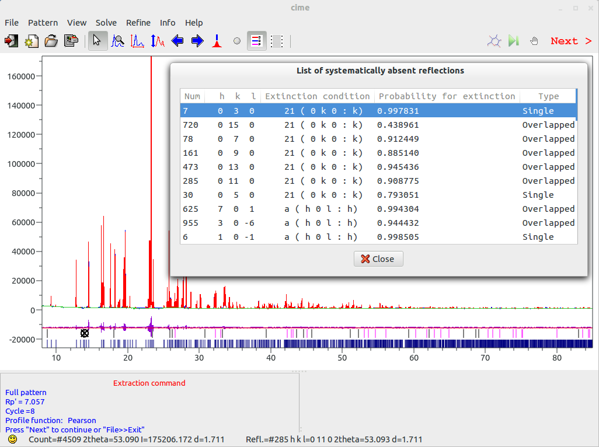

# Space group determination

In the structure solution process the space group determination usually follows the
[indexing](indexing.md). It requires a careful analysis of the experimental intensities
to detect the extinction group. Because the diffraction data collapse onto the
one-dimensional 2θ axis, the pattern suffers from peak overlap and, sometimes, from a
non-trivial background, so deciding whether a reflection is "present" or "absent" may
be ambiguous.

EXPO uses a probabilistic procedure to recognize the extinction symbol. The statistics
of the normalized intensities, extracted by the Le Bail method, is used to compute the
probability of each extinction symbol compatible with the crystal system found by the
indexing. Each reflection intensity is suitably weighted to take its uncertainty into
account, so that large errors on the experimental intensities do not compromise the
identification of the extinction group and, therefore, of the space group. The method
has been tested on a large number of structures in all the crystal systems, with good
results (Altomare *et al.*, 2004, 2005, 2007).

## Running the space group determination

### From an input file

Create a new input file (extension `.exp`) or modify an existing one with a text editor
(see [Preparing the input file](input-file.md)). A typical input file for the space
group determination of cimetidine, starting from the indexed cell, is:

```text
%structure cime
%job cimetidine (C10H16N6S) -- Synchrotron data
%data
pattern cime.dat
wavelength 1.52904
synchrotron
cell 10.69808 18.81786 6.82267 90.00000 111.28911 90.00000
findspace
content (C10H16N6S)4
%continue
```

- `findspace` (a directive of `%data`) activates the space group determination;
- `cell` gives the unit cell parameters, assumed to be known from the indexing;
- `content` gives the unit cell content, which is **mandatory** for the space group
  determination (see [Unit cell content](tutorials.md#unit-cell-content) for how to
  estimate it);
- `synchrotron` is needed only for synchrotron X-ray data.

Load the input file with **File → Load & Go**.

### From the graphical interface

Load the powder diffraction data file with **File → Import Diffraction Pattern**, then
select **Pattern → Spacegroup → Space Group Determination**. Fill in the *Cell
Parameters* and *Cell Content* fields and click **OK** to start the space group
determination.



When the space group determination follows the indexing, the same dialog appears after
a cell has been chosen from the list of plausible cells, with the cell parameters
already filled in.

## The procedure

The main steps of the algorithm are:

1. the integrated intensities are extracted from the experimental pattern by the Le Bail
   algorithm, in the space group with the highest Laue symmetry of the crystal system
   and no extinction conditions (e.g. *P* 1 2/*m* 1 for monoclinic, *P* 2/*m* 2/*m*
   2/*m* for orthorhombic, *P* 4/*m* *m* *m* for tetragonal, *P* 6/*m* *m* *m* for
   trigonal-hexagonal, *P* *m* -3 *m* for cubic);
2. the extracted intensities are normalized by the Wilson method, using the same space
   group;
3. the statistics of the suitably weighted normalized intensities is used to define the
   probability of each extinction symbol;
4. the probability of every extinction symbol possible for the crystal system is
   computed.

Click **Next** on the toolbar to perform the steps. At the end, EXPO lists the most
plausible space groups with their extinction symbol and probability (FoM):



In general several space groups share the same extinction symbol (e.g. *P* 2/*n* and
*P* *n* for the extinction symbol *P* 1 *n* 1), but sometimes only one space group
corresponds to an extinction symbol (e.g. *P* 2~1~/*n* for *P* 1 2~1~/*n* 1).

The other columns of the list help to resolve ambiguities:

| Column       | Meaning                                                                         |
|--------------|---------------------------------------------------------------------------------|
| Nabs         | number of systematically absent reflections not in overlap                      |
| Nasym        | expected number of atoms in the asymmetric unit                                 |
| No. in CSD   | number of occurrences of the space group in the Cambridge Structural Database   |
| % of CSD     | percentage of occurrences in the CSD                                            |
| Rank         | frequency ranking of the space group in the CSD                                 |
| Chiral       | *yes* for chiral (Sohncke) space groups: enantiomerically pure compounds can crystallize only in a chiral space group |

### Systematically absent reflections

Click **List** to see the reflections that should be systematically absent according to
the selected extinction symbol. For each reflection the list gives its number, the
Miller indices, the extinction condition (with the symmetry element responsible for it),
the probability of extinction and the type (single or overlapped reflection).



The list is ordered by extinction condition; click a column title to sort it by a
different criterion. The reflection selected in the list is marked on the pattern.

In the pattern, the reflections expected to be absent are marked by vertical bars below
the observed profile, just above the bars showing the positions of all the reflections.
Single absent reflections (or reflections belonging to a cluster that is entirely
absent) are marked in black, overlapped ones in a different colour. This helps to
discard an unreliable extinction symbol even when its probability is high.

### Choosing the space group

The space group with the highest FoM is not always the correct one, and space groups
with the same systematic absences (same extinction symbol) cannot be distinguished. In
case of ambiguity, more space groups should be tried in the structure solution step; a
good choice is to start from the most frequent one.

Click **OK** to accept the selected space group and continue the structure solution
(see [Direct Methods](direct-methods/index.md)).
The results can be saved in an EXPO project (`.expo`) with **File → Save Project As**,
and reloaded with **File → Load Project**. The list of space groups remains available
from **Pattern → Spacegroup → Space Group List**.

## Output

The output file contains the details of the space group determination. Open it with
**Info → View Output File**, or open `name.out` in the working directory with a text
editor (`name` is the structure name).

When the space group determination is run from an input file with the `findspace`
directive, at the end EXPO creates a new input file named after the original one with
a `1` appended (e.g. `cime1.exp` from `cime.exp`). It contains the selected cell and
space group, and can be loaded to skip the space group determination and go on with the
structure solution.

## References

- Altomare, A., Caliandro, R., Camalli, M., Cuocci, C., da Silva, I., Giacovazzo, C.,
  Moliterni, A. G. G. & Spagna, R. (2004). Space-group determination from powder
  diffraction data: a probabilistic approach. *J. Appl. Cryst.* **37**, 957–966.
  [doi:10.1107/S0021889804023982](https://doi.org/10.1107/S0021889804023982)
- Altomare, A., Camalli, M., Cuocci, C., da Silva, I., Giacovazzo, C., Moliterni,
  A. G. G. & Rizzi, R. (2005). Space group determination: improvements in EXPO2004.
  *J. Appl. Cryst.* **38**, 760–767.
  [doi:10.1107/S0021889805020820](https://doi.org/10.1107/S0021889805020820)
- Altomare, A., Camalli, M., Cuocci, C., Giacovazzo, C., Moliterni, A. G. G. &
  Rizzi, R. (2007). Advances in space-group determination from powder diffraction data.
  *J. Appl. Cryst.* **40**, 743–748.
  [doi:10.1107/S0021889807027501](https://doi.org/10.1107/S0021889807027501)
