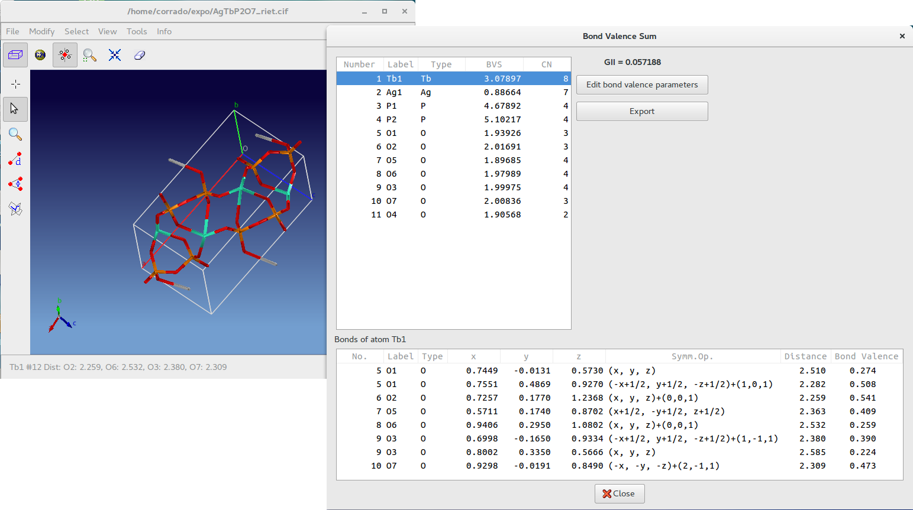
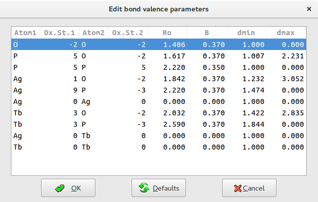

# Bond valence sum

## The bond valence model

The bond valence model (Brese & O'Keeffe, 1991; Brown, 2009) is an important tool to
assess the chemical plausibility of inorganic crystal structures. It is based on the
*valence sum rule*, derived from Pauling's electrostatic valence principle (Pauling,
1929): the sum of the bond valences $S_{ij}$ around an atom *i* is equal to its valence
$V_i$ (formal oxidation state):

$$
V_i = \sum_j S_{ij}
\tag{1}
$$

where the sum runs over all the atoms *j* bonded to *i*. The bond valence $S_{ij}$ can
be seen as a measure of the electrostatic flux between a cation and an anion: it is
related to the strength of the bond and decreases with the bond length. It is
approximated by

$$
S_{ij} = \exp\left( \frac{R_0 - R_{ij}}{B} \right)
\tag{2}
$$

where $R_0$ and $B$ are constants and $R_{ij}$ is the distance between atoms *i* and *j*;
for many bonds $B$ is close to 0.37 Å. EXPO uses the bond valence parameters compiled by
I. D. Brown (`bvparm2016.cif`, available from the
[IUCr bond valence parameters page](https://www.iucr.org/resources/data/datasets/bond-valence-parameters)).
Parameters are not available for all pairs of atoms.

The model is mainly used to check and validate crystal structures, comparing the
expected oxidation states $V_i^0$ with the bond valence sums $V_i$ computed by (1) and
(2). For correct structures the agreement is generally good; large deviations suggest
an incorrect structure (e.g. wrong symmetry or missing atoms) or inappropriate bond
valence parameters.

The bond valence model is also used to describe distortions of a structure from the
ideal one. They are measured by the **global instability index** $G_{II}$, the
root-mean-square deviation of the bond valence sums from the atomic valences over the
*N* atoms:

$$
G_{II} = \sqrt{ \frac{1}{N} \sum_{i=1}^{N} \left( V_i - V_i^0 \right)^2 }
$$

$G_{II}$ is usually smaller than 0.1 v.u. in stable, well-determined structures; values
between 0.1 and 0.2 v.u. indicate strained structures, and room-temperature structures
with $G_{II}$ larger than 0.2 v.u. are rare.

Bond valence sums can also be used as restraints in the solution by direct-space methods
(see [Bond valence restraints](../direct-space/directives.md#bond-valence-restraints)).

## Checking the bond valence sums

Select **Tools → Bond Valence Sum**. For the phosphate AgTbP~2~O~7~ the result is:

The upper list shows, for each atom, the bond valence sum (BVS) and the coordination
number (CN). The lower list shows the bonds contributing to the BVS of the selected atom,
with their lengths and bond valences, the fractional coordinates and the symmetry
operator applied to the atom of the asymmetric unit. In the example, the Tb–O bonds of
Tb1 give a bond valence sum of 3.08. The window also shows $G_{II}$, and **Export**
saves all the information to a text file.

**Edit bond valence parameters** shows the parameters $R_0$ and $B$ for each pair of
elements:

{ width="480" }

Check that the values are reasonable and correct them if needed. For each pair, EXPO
takes the parameters from the database and assigns a *bond window*, the range of
distances $d_{min}$–$d_{max}$ within which two atoms are considered bonded, following
some of the rules of Altermatt & Brown (1985):

- bonds are assumed to form only between atoms of different electronegativity, so pairs
  such as P–P or O–O are excluded by setting $d_{min} = 1$ and $d_{max} = 0$;
- if the parameters of a pair are not in the database, they are set to $R_0 = 0$,
  $B = 0$, $d_{min} = 1$ and $d_{max} = 0$, so that the pair does not contribute to the
  BVS.

When the oxidation state is not given by the user, EXPO assigns the most probable one.

## References

- Altermatt, D. & Brown, I. D. (1985). *Acta Cryst.* B**41**, 240–244.
  [doi:10.1107/S0108768185002051](https://doi.org/10.1107/S0108768185002051)
- Brese, N. E. & O'Keeffe, M. (1991). *Acta Cryst.* B**47**, 192–197.
  [doi:10.1107/S0108768190011041](https://doi.org/10.1107/S0108768190011041)
- Brown, I. D. (2009). *Chem. Rev.* **109**, 6858–6919.
  [doi:10.1021/cr900053k](https://doi.org/10.1021/cr900053k)
- Pauling, L. (1929). *J. Am. Chem. Soc.* **51**, 1010–1026.
  [doi:10.1021/ja01379a006](https://doi.org/10.1021/ja01379a006)
