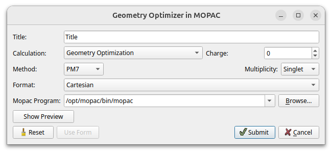
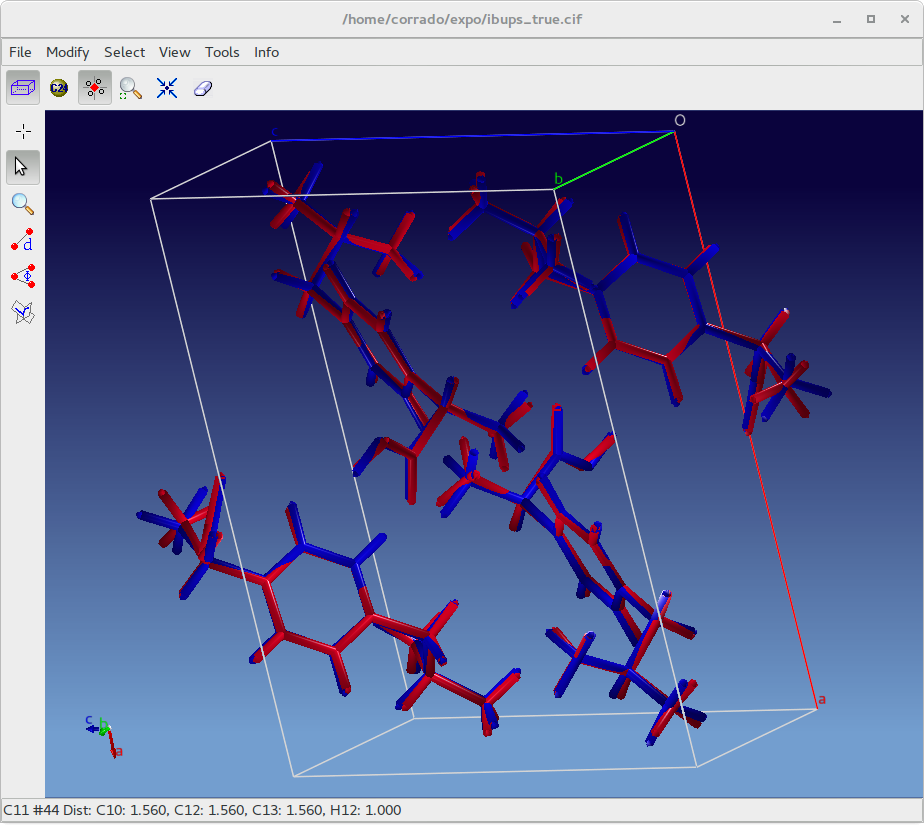

# Geometry optimization

Quantum-chemical calculations complement X-ray powder diffraction data at several
stages of the structure determination:

- to optimize the molecular geometry in the gas phase, obtaining an accurate starting
  model for the solution by [direct-space methods](../direct-space/index.md). Several
  levels of theory can be used: molecular mechanics, semi-empirical methods,
  Hartree–Fock, density functional theory (DFT);
- to minimize the energy of the crystal structure and provide reasonable bond lengths
  and angles, used as restraints in the [Rietveld refinement](../rietveld.md). These
  calculations use plane-wave DFT with dispersion correction (DFT-D);
- to locate the hydrogen atoms, which are difficult to find from powder data: their
  positions are optimized with the cell and the non-hydrogen atoms fixed at the values
  of the Rietveld refinement;
- to resolve ambiguities, e.g. on the orientation of a functional group, that the
  diffraction data alone cannot settle;
- to refine the structure when the Rietveld refinement gives an inaccurate molecular
  geometry: solid-state DFT-D optimization gives results with an accuracy comparable to
  single-crystal refinements;
- to assess the correctness of organic crystal structures determined from powder data.

The first optimization should use a fast level of theory, such as molecular mechanics or
a semi-empirical method. The resulting geometry, close to the correct one, is then the
starting point of a second optimization at a more accurate level (e.g. DFT).

## Molecular mechanics

In molecular mechanics (MM) the energy of a molecule is a sum of simple classical terms:
the molecule is described as a set of balls (the atoms) held together by springs (the
bonds); no wave function is computed and electrons are not treated explicitly. The total
potential energy is usually the sum of the bond stretching, bending, torsion and
non-bonded terms:

$$
E_{tot} = E_{str} + E_{bend} + E_{tor} + E_{non\text{-}bond}
$$

where the last term includes van der Waals, steric and electrostatic interactions between
atoms not bonded to each other. The functional form of these terms and their parameters,
obtained from spectroscopic data or *ab initio* calculations, define a *force field*.
The optimized geometry is the one where all the forces on the nuclei vanish:

$$
f_i = -\frac{\partial E_{tot}}{\partial q_i} = 0
$$

where $q_i$ are the coordinates of the *i*-th atom.

EXPO uses two force fields, through the `OBForceField` class of the Open Babel library
(O'Boyle *et al.*, 2011):

- the **Merck molecular force field** (MMFF94), for organic molecules and biomolecules
  (Halgren, 1996);
- the **Universal force field** (UFF), covering the whole periodic table and widely used
  for systems containing inorganic elements (Rappé *et al.*, 1992).

Select **Tools → Optimize Geometry → Optimize**: MMFF94 is applied and, if it fails (e.g.
with inorganic elements), UFF is used. **Modify → Undo** restores the initial geometry.

The optimization can be limited to selected atoms:

1. activate the selection mode (**Select → Selection Mode → Atoms or Bonds**);
2. select the atoms with the mouse;
3. choose **Tools → Optimize Geometry → Optimize Selected Atoms**.

For example, to optimize only the hydrogen atoms, keeping all the others fixed, select
them with **Select → Select Type → H** and then choose
**Tools → Optimize Geometry → Optimize Selected Atoms**.

Molecular mechanics is fast and, for small and medium-sized molecules, can be quite
accurate. Even when its geometries are not very accurate, it gives good starting
geometries for semi-empirical, *ab initio* or DFT calculations, which is one of its main
uses.

## Semi-empirical methods: MOPAC

Semi-empirical methods use an approximate Hamiltonian and replace many integrals with
parameters derived from experimental data, while *ab initio* methods compute all the
integrals from the exact Hamiltonian, using only fundamental constants. Semi-empirical
calculations are much faster than Hartree–Fock or DFT ones and can be applied routinely
to large systems.

[MOPAC](https://openmopac.net/) (Molecular Orbital PACkage) is one of the most widely
used semi-empirical programs. It is not distributed with EXPO and must be installed
separately; it is now open source. EXPO provides an interface to MOPAC for gas-phase
geometry optimizations, useful to generate molecular models with accurate bond lengths
and angles for the solution by direct-space methods.

Before the calculation, add the missing hydrogen atoms (**Tools → Add Hydrogens**). Then
select **Tools → Optimize Geometry → MOPAC**:

{ width="520" }

**Title**
:   title of the calculation (e.g. the name of the molecule), written in the second line
    of the MOPAC input file.

**Calculation**
:   *Geometry Optimization*, *Geometry Optimization of Hydrogens Only* (the other atoms
    are kept fixed) or *Single Point Energy* (energy calculation only).

**Method**
:   semi-empirical Hamiltonian: AM1, MNDO, MNDO-d, PM3, PM6, PM7 or RM1. Not all elements
    are supported by every method; see the [MOPAC manual](https://openmopac.net/manual/).

**Charge**
:   charge of the system.

**Multiplicity**
:   number of singly occupied orbitals: singlet (default; closed shell, as for most
    organic molecules), doublet (one singly occupied orbital, e.g. organic radicals),
    triplet, and so on. If it is not known, all the possibilities should be tried.

**Format**
:   geometry in Cartesian coordinates or as a Z-matrix; with a Z-matrix the position of
    the molecule in the unit cell is lost.

**Mopac Program**
:   MOPAC executable. EXPO finds it automatically if it is in the `PATH` or in a
    standard directory (`C:\Program Files\MOPAC` on Windows, `/opt/mopac` on Linux);
    otherwise it must be selected with **Browse**.

Click **Submit** to run MOPAC. At the end the new geometry is displayed, and the output
file `name_mopac.out` is written in the working directory; it can be viewed with
**Tools → Optimize Geometry → View MOPAC Output**. MOPAC output files can also be read
with **File → Import Structure**, choosing the MOPAC output format.

A wrong starting geometry, missing hydrogen atoms or a wrong multiplicity can give
incorrect results. In this case restore the initial geometry with **Modify → Undo** and
look for the cause in the output file.

Further calculations can be set up with **Show Preview**, editing the MOPAC input file.
For example, the keyword `BONDS` in the first line prints the bond orders between all
pairs of atoms. The full list of keywords is in the
[MOPAC manual](https://openmopac.net/manual/allkeys.html).

## Density functional theory

Density functional theory (DFT), closely related to *ab initio* methods, does not compute
the wave function: it determines the electron density ρ directly, and from it the energy
of the system.

EXPO writes input files for quantum chemistry programs:

- with **File → Export Structure**, for molecular calculations with GAMESS, NWChem and
  Gaussian;
- with **Tools → Optimize Crystal Structure by DFT-D**, for the optimization of the
  crystal structure by plane-wave DFT with Grimme dispersion correction, in the formats
  of Quantum ESPRESSO, NWChem, ABINIT and CRYSTAL.

To obtain accurate interatomic distances, test the convergence with respect to the
cutoff energy and to the sampling of the Brillouin zone.

At the end, the output of the quantum chemistry program can be imported in EXPO, and the
optimized structure compared with the experimental one with
**Tools → Overlay Structures**:

{ width="460" }

*Overlay of the experimental (red) and optimized (blue) crystal structure of ibuprofen;
the optimization was carried out by DFT-D3 with NWChem.*

The agreement between experimental and calculated structures can be measured by the
root-mean-square displacement (RMSD) of the non-hydrogen atoms, shown by
**Tools → Overlay Info**. In a study of 215 organic crystal structures determined from
powder data and published in IUCr journals, energy-minimized by DFT-D and compared with
the experimental ones, the RMSD never exceeded 0.35 Å for correct structures (van de
Streek & Neumann, 2014).

## References

- Halgren, T. A. (1996). *J. Comput. Chem.* **17**, 490–519.
  [doi:10.1002/(SICI)1096-987X(199604)17:5/6<490::AID-JCC1>3.0.CO;2-P](https://doi.org/10.1002/%28SICI%291096-987X%28199604%2917%3A5%2F6%3C490%3A%3AAID-JCC1%3E3.0.CO%3B2-P)
- O'Boyle, N. M., Banck, M., James, C. A., Morley, C., Vandermeersch, T. &
  Hutchison, G. R. (2011). *J. Cheminform.* **3**, 33.
  [doi:10.1186/1758-2946-3-33](https://doi.org/10.1186/1758-2946-3-33)
- Rappé, A. K., Casewit, C. J., Colwell, K. S., Goddard, W. A. & Skiff, W. M. (1992).
  *J. Am. Chem. Soc.* **114**, 10024–10035.
  [doi:10.1021/ja00051a040](https://doi.org/10.1021/ja00051a040)
- van de Streek, J. & Neumann, M. A. (2014). *Acta Cryst.* B**70**, 1020–1032.
  [doi:10.1107/S2052520614022902](https://doi.org/10.1107/S2052520614022902)
