# Tutorials

Three test structures are distributed with EXPO. They show the main paths of the
structure solution process:

1. [Cimetidine](#tutorial-1-cimetidine-direct-methods-default-run): complete
   *ab initio* solution, from indexing to Direct Methods, in a default run;
2. [2-Mercaptobenzoic acid](#tutorial-2-2-mercaptobenzoic-acid-exploring-the-phasing-trials):
   what to do when the default Direct Methods run fails;
3. [Paracetamol](#tutorial-3-paracetamol-direct-space-methods): solution by
   direct-space methods (simulated annealing).

## Opening the examples

All the files needed by the tutorials are in the EXPO *examples* folder:

1. Start EXPO.
2. Select **File → Load Examples**.

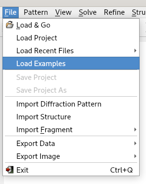{ width="240" }

The first time this command is used, EXPO copies the examples into the folder
`share/expo/examples` of your home directory (see
[Running the examples](installation.md#running-the-examples)), and then opens a file
dialog on that folder.

Selecting an input file (`.exp`), you can view and, if necessary, modify it with the
**Edit** button, then start the run with **Open**. If the output file (e.g. `cime.out`)
already exists, EXPO displays a warning before overwriting it.

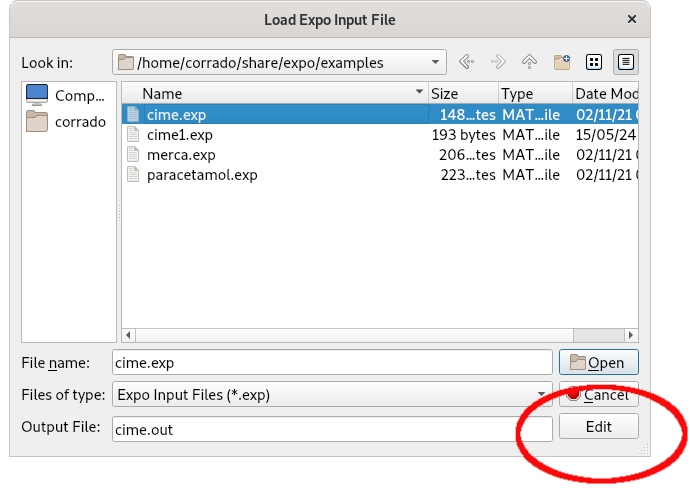{ width="450" }

## Tutorial 1 – Cimetidine: Direct Methods, default run

This tutorial is a complete walkthrough of the *ab initio* crystal structure solution of
cimetidine, from indexing to the structure solution by Direct Methods.

{ width="350" }

The only information required by EXPO is the experimental powder diffraction pattern and
the chemical formula, C~10~H~16~N~6~S. The files used are:

- `cime.exp`: the EXPO input file;
- `cime.dat`: synchrotron X-ray diffraction data. The first line contains the initial
  2θ value, the 2θ step and the final 2θ value; the following lines contain the
  experimental counts.

Select `cime.exp` in the examples folder. Its content is:

```text
%structure cime
%job cimetidine (C10H16N6S) -- Synchrotron data
%data
pattern cime.dat
wavelength 1.52904
synchrotron
%ntreor
%continue
```

The `%data` command provides the minimal required information: the name of the data
file, the wavelength and the type of radiation (when different from laboratory X-rays).
`%ntreor` activates the indexing process and `%continue` the *ab initio* structure
solution.

### Indexing

Click **Open**: the powder diffraction pattern is displayed. Clicking **Next**, an
automatic peak search is performed and the d-values of the experimental peaks are passed
to the indexing process.

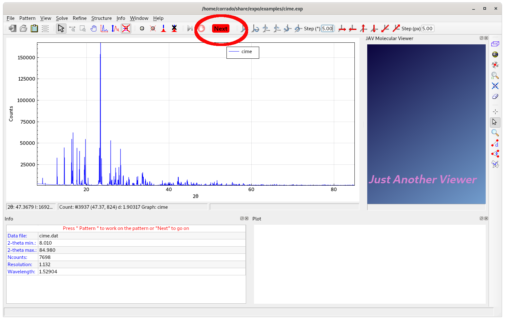

At the end, EXPO shows the indexing results:

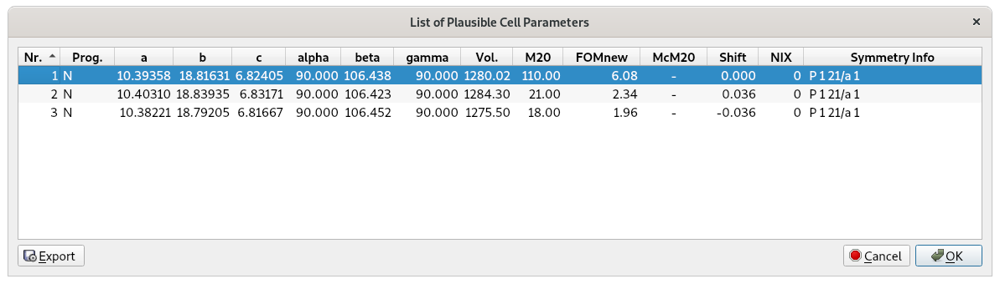

Click **OK** to accept the selected cell parameters and proceed to the space group
determination.

### Unit cell content

The space group determination and Direct Methods need the unit cell content. It can be
estimated from the molecular formula and from the cell volume V~cell~, which EXPO
computes from the cell parameters and shows in the graphical interface and in the
output file.

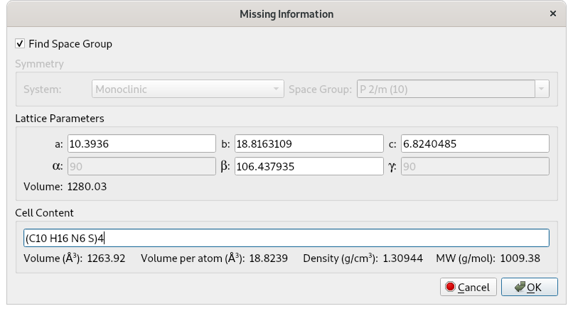

The cell content is obtained by multiplying the molecular formula by Z, the number of
molecules in the unit cell:

Z = V~cell~ / V~mol~

The molecular volume V~mol~ can be estimated in one of two ways:

- **18 ų rule**: count the non-hydrogen atoms of the chemical formula and multiply this
  number by 18 ų;
- **approximate atomic volumes**: 14 ų for C, 12 ų for N, 11 ų for O, 5 ų for H,
  25 ų for S, 26 ų for Cl.

For cimetidine, C~10~H~16~N~6~S, the cell volume is about 1280 ų:

- 18 ų rule: V~mol~ = 18 × 17 = 306 ų, so Z = 1280 / 306 ≈ 4.2;
- atomic volumes: V~mol~ = 14 × 10 + 5 × 16 + 12 × 6 + 25 × 1 = 317 ų, so
  Z = 1280 / 317 ≈ 4.0.

Both estimates give **Z = 4**: the unit cell contains 4 molecules of cimetidine, and the
cell content to supply to EXPO is either `(C10 H16 N6 S)4` or `C40 H64 N24 S4`.
The formula must follow the same rules as the `content` directive of the `%data`
command.

### Space group determination

Click **OK** to perform the space group determination, then click **Next**. At the end,
EXPO lists the extinction symbols and space groups compatible with the lattice symmetry,
ranked by probability:

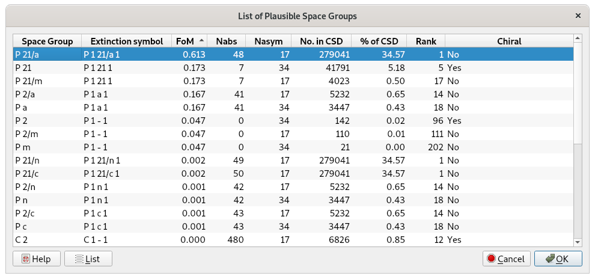

The most probable extinction symbol, P 1 2~1~/a 1, is selected automatically. Clicking
**OK**, the corresponding space group P 2~1~/a is applied. EXPO then asks whether to
transform P 2~1~/a into the standard setting P 2~1~/c: keep **No** selected to continue
with P 2~1~/a.

### Intensity extraction and Direct Methods

EXPO now extracts the integrated intensities from the experimental pattern, using the
selected space group. Click **Next**: the extracted intensities are passed automatically
to Direct Methods, and the final structure model is shown in the JAV molecular viewer.

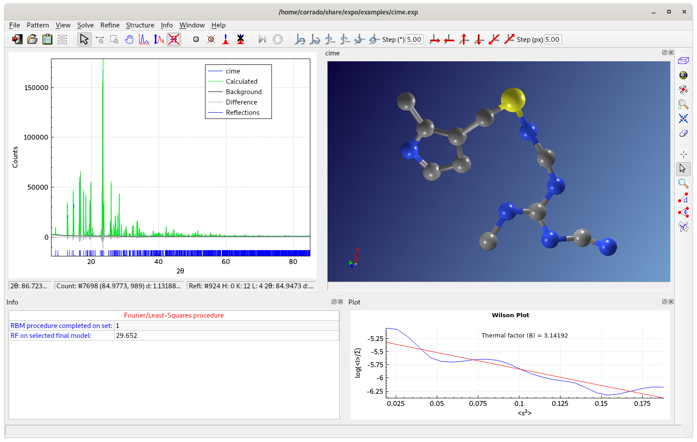

If some carbon or nitrogen atoms are assigned the wrong species in the final model, they
can be corrected with the commands of the **Modify** menu of the structure viewer.
Hydrogen atoms can be added in calculated positions with **Tools → Add Hydrogens**.

## Tutorial 2 – 2-Mercaptobenzoic acid: exploring the phasing trials

This tutorial shows what to do when the default Direct Methods run of EXPO does not give
the correct structure.

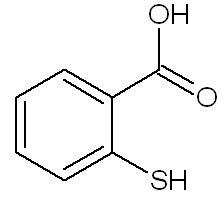{ width="200" }

Select `merca.exp` in the examples folder. Its content is:

```text
%Structure merca
%Job 2-Mercaptobenzoic acid (C7 H6 O2 S)
%Data
Cell       7.885  5.976   14.949  90.0  100.48  90
SpaceGroup p 21/c
Content   (C7 H6 O2 S)4
Pattern    merca.xy
Wavelength 1.54056
%continue
```

Here the cell and the space group are assumed to be already known, and the unit cell
contains 4 molecules of C~7~H~6~O~2~S.

Click **Open** and then **Next** repeatedly until the end of the run. The final model
proposed by EXPO is not chemically interpretable, so it does not correspond to the
correct crystal structure.

In a default run, Direct Methods generate several phasing trials. At most 20 of them
are stored, ranked in decreasing order of a combined figure of merit (CFOM), and the
trial with the highest CFOM is used for the structure solution. When this trial does not
lead to the correct structure, the **ALLTRIALS** procedure explores the remaining stored
trials looking for the correct solution. From the graphical interface:

1. select **Solve → Explore Trials**;
2. check **Explore trials not processed yet**;
3. click **Explore**.

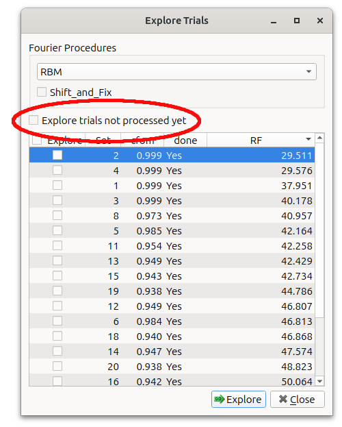{ width="380" }

At the end of the procedure, EXPO ranks the phasing trials (and the corresponding
structure models) in order of increasing R~F~ agreement factor. The best solution, with
the lowest R~F~, is selected and displayed. Close the *Explore Trials* window: some
atomic species in the selected model may be wrong and should be corrected as described
in Tutorial 1.

## Tutorial 3 – Paracetamol: direct-space methods

This tutorial guides you through the solution of paracetamol (form I polymorph) by
direct-space methods, using the simulated annealing algorithm.

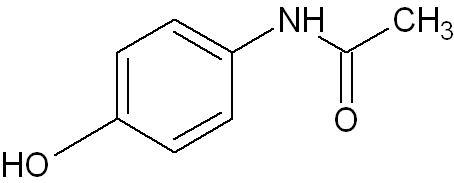{ width="350" }

Select `paracetamol.exp` in the examples folder. Its content is:

```text
%Structure paracetamol
%Initialize
%Job Paracetamol (C8H9NO2)
%Data
   Cell  7.100  9.380  11.708  90.0  97.42  90.0
   SpaceGroup p 21/n
   Pattern   paracetamol.xy
   Wavelength 1.54056
%fragment paracetamol.mol
%sanneal
```

Cell and space group are known; `%fragment` gives the molecular model (file
`paracetamol.mol`) to be located in the unit cell, and `%sanneal` activates the
simulated annealing.

Click **Open**: the starting model is displayed together with the simulated annealing
window. Click **Run** to start the procedure, which performs several independent runs
(10 by default).

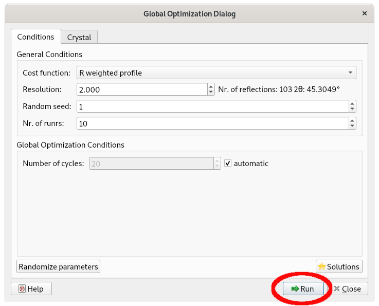

The models obtained in the different runs can be explored with the **Solutions** button.
They are ranked by the value of the cost function and can be visualized and analyzed; a
CIF file is written for each model. Select a solution and click **Save** to keep it.

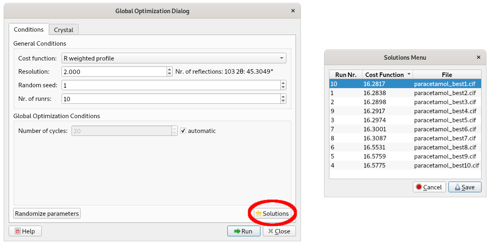

## References

- **Cimetidine** – Cernik, R. J., Cheetham, A. K., Prout, C. K., Watkin, D. J.,
  Wilkinson, A. P. & Willis, B. T. M. (1991). *J. Appl. Cryst.* **24**, 222–226.
  [doi:10.1107/S0021889890013486](https://doi.org/10.1107/S0021889890013486)
- **2-Mercaptobenzoic acid** – Steiner, T. (2000). *Acta Cryst.* C**56**, 876–877.
  [doi:10.1107/S0108270100005898](https://doi.org/10.1107/S0108270100005898)
- **Paracetamol (form I)** – Nichols, G. & Frampton, C. S. (1998). *J. Pharm. Sci.*
  **87**, 684–693.
  [ScienceDirect](https://www.sciencedirect.com/science/article/pii/S002235491550590X)
